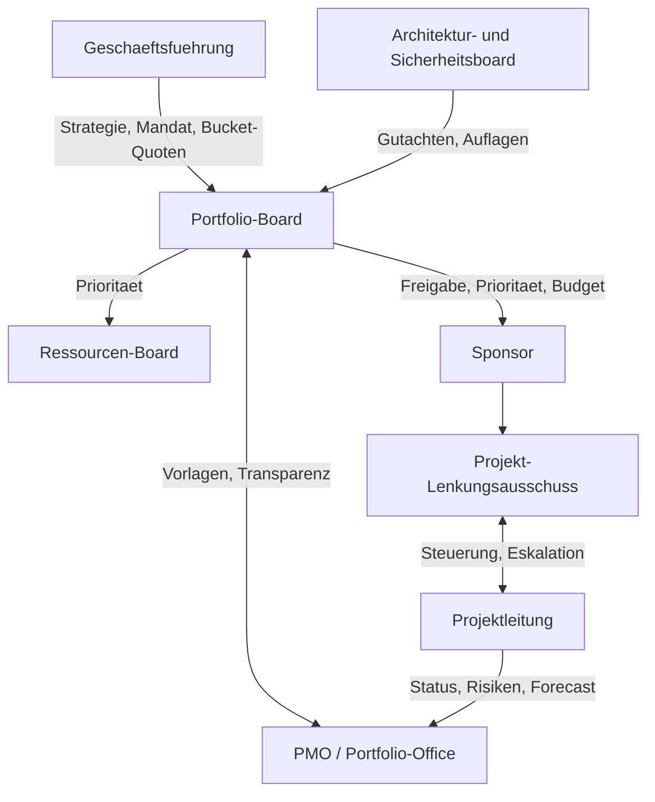
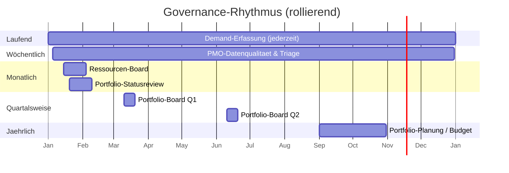
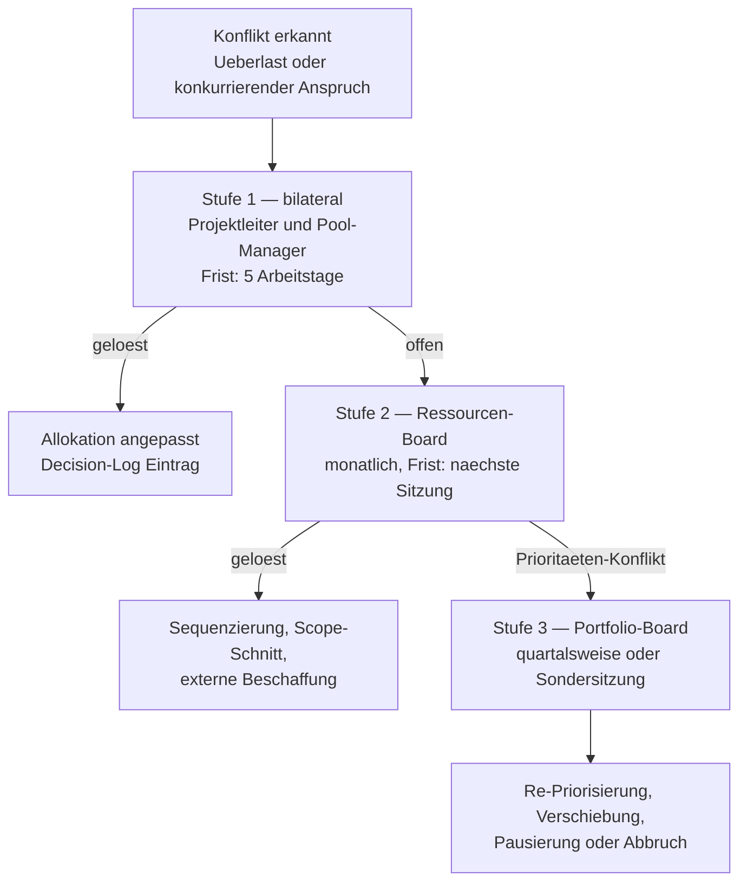

# 01 — Governance-Modell: Prinzipien, Gremien, Rollen

## 1. Zweck der Governance

Projekt-Governance ist der verbindliche Rahmen, der festlegt **wer** auf **welcher Datenbasis**
**wann** entscheidet, welche Vorhaben das Unternehmen mit seinen knappen Ressourcen durchführt —
und wer für das Ergebnis geradesteht.

Sie erfüllt vier Funktionen:

1. **Allokation** — knappe Kapazität auf die Vorhaben mit dem höchsten Wertbeitrag lenken
2. **Legitimation** — Entscheidungen nachvollziehbar und gegenüber Verlierern begründbar machen
3. **Kontrolle** — laufende Vorhaben gegen Plan, Nutzen und Risiko überwachen, notfalls stoppen
4. **Lernen** — realisierten Nutzen gegen versprochenen Nutzen messen und in künftige Bewertungen zurückspeisen

> **Leitgedanke:** Die Software macht Governance verbindlich und transparent und bereitet
> Entscheidungen vor. Sie **ersetzt weder ein wirksames Mandat noch die Verantwortung** der
> Führungskräfte und Gremien. Ein Tool ohne verabschiedetes Kompetenzmodell (Abschnitt 4.2)
> digitalisiert nur die Unklarheit.

### 1.1 Governance-Ebenen und Abgrenzung

| Ebene | Leitfrage | Verantwortung | Abdeckung durch die App |
|---|---|---|---|
| **Strategie-Governance** | Welche strategischen Ziele und Investitionsfelder sind maßgeblich? | Geschäftsführung | Ziele, Zielhierarchie, Bucket-Quoten als Vorgabe (nativ, schlank) |
| **Portfolio-Governance** | Welche Vorhaben werden aufgenommen, priorisiert, finanziert, verändert oder beendet? | Portfolio-Board, PMO | **Kern der App** |
| **Projekt-Governance** | Wird das einzelne Vorhaben innerhalb seiner Leitplanken wirksam geführt? | Sponsor, Lenkungsausschuss, PL | **Kern der App** (Gates, Status, Risiken, Changes, Nutzen) |
| **Operatives Projektmanagement** | Wie wird die vereinbarte Arbeit umgesetzt? | PL, Team | **nicht** in der App — Gantt, Deck oder andere Planungstools über Schnittstelle (Kapitel 07) |

## 2. Gestaltungsprinzipien

| # | Prinzip | Konsequenz für das Tool |
|---|---|---|
| P1 | **Ein Eingang.** Jeder Bedarf beginnt als Demand im System — kein Projekt entsteht per Zuruf. | Demand-Formular ist der einzige Startpunkt; Projekte ohne Demand-Herkunft sind nicht anlegbar |
| P2 | **Entscheidung nur mit Datenbasis.** Kein Gate ohne vollständige Pflichtfelder der jeweiligen Stufe. | Gate-Einreichung wird durch Vollständigkeitsprüfung blockiert |
| P3 | **Nachvollziehbarkeit.** Jede Entscheidung mit Datum, Gremium, Begründung, Stimmbild, Alternativen. | Decision-Objekt, unveränderlich nach Beschluss, Audit-Log |
| P4 | **Kapazität schlägt Wunsch.** Freigabe erst, wenn die Engpassrollen zugesagt haben. | Gate G3 prüft harte Allokation gegen Pool-Kapazität |
| P5 | **Begrenzte Parallelität.** WIP-Limit je Ressourcenpool statt gleichzeitigem Anstarten aller Vorhaben. | Warnung/Blocker bei Überschreitung; Sequenzierungsvorschlag |
| P6 | **Proportionalität.** Kleinvorhaben durchlaufen einen verkürzten Pfad. | Vorhabensklassen mit unterschiedlichem Gate-Set |
| P7 | **Nutzen wird nachgehalten.** Der Business Case endet nicht mit Go-Live. | Gate G6 Benefit-Review, Soll/Ist-Vergleich je Nutzenposition |
| P8 | **Transparenz nach Bedarf.** Jeder Beteiligte sieht, was er zum Handeln braucht — nicht mehr, nicht weniger. | Rollenbasierte Sichten und Berechtigungsmatrix (Kapitel 06) |
| P9 | **Mandat vor Werkzeug.** Für jeden Entscheidungstyp ist genau eine Instanz entscheidungsberechtigt, abhängig von Schwellenwerten. | Entscheidungsrechte-Matrix als Konfiguration (Abschnitt 4.2); das Tool leitet daraus ab, wer entscheiden darf |
| P10 | **Stoppen ist ein legitimes Ergebnis.** Bereits investierter Aufwand ist kein Argument für die Fortsetzung. | Abbruch ist ein regulärer Gate-Beschluss; Gates zeigen Restaufwand und Restnutzen, nicht die versunkenen Kosten; Abbruchquote wird nicht negativ bewertet |
| P11 | **Status und Gesundheit sind zwei Dinge.** Die Selbstmeldung des PL wird gegen objektive Indikatoren gespiegelt. | Statusampel (gemeldet) und Health-Indikator (berechnet) getrennt; Widersprüche werden markiert (Kapitel 02, 4.5) |
| P12 | **Einmal erfassen, ein führendes System.** Je Datenfeld genau eine Quelle; Herkunft ist sichtbar. | Feldhoheit je Integration (Kapitel 07), Kennzeichnung „manuell“ vs. „aus System X“ |

## 3. Gremien

Die Struktur ist ein Beispiel. In kleineren Organisationen fallen Gremien zusammen (z. B.
Portfolio- und Ressourcen-Board in einer Sitzung); das Tool bildet Gremien deshalb als
**konfigurierbare Objekte** ab, nicht als feste Liste.

### 3.0 Geschäftsführung

- **Zweck:** Mandat und Leitplanken setzen, nicht Einzelvorhaben entscheiden
- **Entscheidet:** strategische Ziele, jährliche Bucket-Quoten und Kapazitätsrahmen, Mandat und
  Schwellenwerte der Gremien, Eskalationen oberhalb des Portfolio-Boards

### 3.1 Portfolio-Board (Investment Committee)

- **Zweck:** oberste Priorisierungs- und Investitionsentscheidung
- **Besetzung:** Geschäftsführung/Vorstand, Leiter der Geschäftsbereiche, CIO, CFO; PMO als Sekretariat ohne Stimme
- **Kadenz:** quartalsweise, zusätzlich jährliche Portfolio-Planung
- **Entscheidet:** Gate G2 (Portfolio-Aufnahme), Gate G3 (Freigabe großer Vorhaben), Priorisierungsreihenfolge, Budget-Buckets, Abbruch von Vorhaben, Eskalationen der Stufe 3
- **Entscheidungsregel:** Konsens angestrebt; sonst Mehrheit, bei Gleichstand entscheidet der Vorsitz. Vetorecht des CIO nur bei nachgewiesener technischer Nichtmachbarkeit oder Sicherheits-/Compliance-Verstoß

### 3.2 Ressourcen-Board (Capacity Board)

- **Zweck:** operative Zuteilung der Kapazität in der Reihenfolge der Portfolio-Priorität
- **Besetzung:** Leiter der Ressourcenpools (Linienmanager), PMO (Vorsitz), Projektleiter der betroffenen Vorhaben als Gäste
- **Kadenz:** monatlich, rollierender Planungshorizont 6–12 Monate
- **Entscheidet:** Umwandlung von Soft- in Hard-Allokation, Sequenzierung konkurrierender Vorhaben, Auflösung von Überlast (Verschieben, Scope-Schnitt, externe Beschaffung), Eskalationen der Stufe 2
- **Entscheidungsregel:** höhere Portfolio-Priorität hat Vorrang; Abweichungen davon sind begründungspflichtig und werden protokolliert

### 3.3 Architektur- und Sicherheitsboard (Technical Review)

- **Zweck:** technische Machbarkeit, Standardkonformität, Sicherheits- und Datenschutzbewertung
- **Besetzung:** Enterprise-Architekt, IT-Security, Datenschutz, Betriebsleitung
- **Kadenz:** zweiwöchentlich oder anlassbezogen
- **Entscheidet:** keine Investitionsentscheidung, sondern **Bewertungsbeitrag** — liefert Risikoeinschätzung, Aufwandsplausibilisierung und Auflagen an das Portfolio-Board. Kann Auflagen erteilen, die Freigabebedingung werden

### 3.4 Portfolio-Office / PMO

- **Zweck:** Betrieb des Verfahrens, nicht Entscheidung
- **Aufgaben:** Demands aufnehmen und qualifizieren, Bewertungen konsolidieren, Entscheidungsvorlagen erstellen, Datenqualität sichern, Kennzahlen berichten, Gate-Termine steuern, Beschlüsse nachhalten
- **Wichtig:** Das PMO ist *neutral*. Es bewertet nicht selbst, sondern stellt sicher, dass die Bewertung nach den vereinbarten Regeln zustande kommt

### 3.5 Projekt-Lenkungsausschuss (Steering Committee)

- **Zweck:** Projekt-Governance für ein einzelnes Vorhaben der Klasse M/L innerhalb der vom
  Portfolio-Board gesetzten Leitplanken (Budget, Termin, Scope, Nutzen)
- **Besetzung:** Sponsor (Vorsitz), Vertreter der betroffenen Fachbereiche, ggf. Pool-Manager der
  Engpasspools, PL berichtet
- **Kadenz:** monatlich oder an Meilensteinen
- **Entscheidet:** Change Requests **unterhalb** der Board-Schwelle, Maßnahmen bei gelber Ampel,
  Freigabe von Budgettranchen innerhalb des genehmigten Rahmens, Eskalation an das Portfolio-Board
  bei Überschreiten des Mandats
- **Nicht:** Priorität gegenüber anderen Vorhaben, Zusatzkapazität aus Engpasspools — das bleibt
  beim Ressourcen- bzw. Portfolio-Board

## 4. Rollen

| Rolle | Verantwortung | Typischer Träger |
|---|---|---|
| **Antragsteller (Requestor)** | Bedarf beschreiben, fachliche Fragen beantworten | beliebiger Mitarbeitender |
| **Business Owner / Sponsor** | Business Case verantworten, Nutzen zusagen und später nachweisen, Budget bereitstellen | Fachbereichsleitung |
| **Projektleiter** | Planung, Durchführung, Statusbericht, Ressourcenanforderung, Change Requests | PL aus Fachbereich oder IT |
| **Ressourcenpool-Manager** | Kapazität seines Pools bewirtschaften, Zusagen erteilen, Überlast melden | Team-/Linienleitung |
| **Portfolio-Manager** | Portfoliosicht, Priorisierungslogik, Vorbereitung Portfolio-Board | PMO-Leitung |
| **Board-Mitglied** | Entscheiden, Stimmabgabe, Interessenkonflikt offenlegen | Führungskreis |
| **Fachgutachter** | Bewertungsbeitrag zu Architektur, Security, Datenschutz, Recht, Betrieb | Experten |
| **Controller** | Kosten- und Nutzenzahlen plausibilisieren, Ist-Kosten liefern | Finance |
| **Benefit Owner** | Verantwortet eine Nutzenposition über den Projektabschluss hinaus und meldet Ist-Werte | Linienverantwortliche des nutznießenden Bereichs; kann vom Sponsor abweichen, **sollte nicht der PL sein** |
| **Lenkungsausschuss-Mitglied** | Projektentscheidungen innerhalb des Mandats | Sponsor, Fachbereichsvertreter |
| **Revisor / Auditor** | Prüft Entscheidungen, Änderungen und Gate-Compliance, nur lesend | Interne Revision, Compliance |
| **Daten-Owner** | Fachlich verantwortlich für Aktualität und Richtigkeit eines Objekttyps (z. B. Pool-Kapazität, Kriterienkatalog) | jeweils benannte Rolle, siehe Kapitel 05, 10 |
| **Beobachter (Viewer)** | Informationsbedarf ohne Entscheidungsrolle | Betriebsrat, Betrieb, angrenzende Bereiche |

**Stellvertretung:** Jede entscheidende Rolle kann zeitlich befristet vertreten werden
(`valid_from`/`valid_to` an der Rollenzuweisung). Vertretene Entscheidungen werden mit beiden
Namen protokolliert.

### 4.1 RACI je Kernentscheidung

R = durchführend, A = rechenschaftspflichtig, C = konsultiert, I = informiert

| Aktivität | Antragsteller | Sponsor | PL | Pool-Manager | PMO | Arch./Sec | Ress.-Board | Portf.-Board |
|---|---|---|---|---|---|---|---|---|
| Demand einreichen | R/A | C | – | – | I | – | – | – |
| Qualifizierung (G1) | C | C | – | – | R/A | C | – | I |
| Business Case erstellen | C | **A** | R | C | C | C | – | I |
| Bewertung/Scoring (G2) | – | C | C | C | R | C | I | **A** |
| Ressourcenzusage (G3) | – | C | R | **A** | C | – | R | I |
| Projektfreigabe (G3) | – | C | C | C | R | C | C | **A** |
| Phasenfreigabe (G4) | – | C | R | C | C | C | I | **A** |
| Change Request > Schwelle | – | C | R | C | C | C | C | **A** |
| Abbruchentscheidung | I | C | C | C | R | C | C | **A** |
| Abnahme / Go-Live (G5) | I | **A** | R | I | C | C | – | I |
| Nutzenreview (G6) | I | **A** | C | – | R | – | – | I |

**Regel:** Je Aktivität genau **ein** A. Ein „A“, das auf mehrere Rollen verteilt ist, ist in der
Praxis keins.

### 4.2 Entscheidungsrechte-Matrix (Mandate und Schwellen)

Die RACI beschreibt Verantwortung, die Entscheidungsrechte-Matrix beschreibt **Befugnis**. Sie ist
im Tool Konfiguration (`DECISION_RIGHT`, Kapitel 05) und bestimmt, an welches Gremium ein Antrag
geht, wer abstimmen darf und welches Quorum gilt.

| Entscheidungstyp | Vorbereitung | Entscheidung (Beispiel) | Schwelle (Beispiel, konfigurierbar) | Beteiligt |
|---|---|---|---|---|
| Strategische Ziele, Bucket-Quoten | Strategie, PMO | Geschäftsführung | – | Portfolio-Board |
| Aufnahme in den Demand-Prozess (G0/G1) | Antragsteller, PMO | PMO | – | Fachgutachter |
| Portfolio-Aufnahme und Rang (G2) | PMO | Portfolio-Board | Klasse M/L; S delegiert an PMO | Finance, Pool-Manager |
| Projektfreigabe (G3) | Sponsor, PL | Portfolio-Board; Klasse S: PMO + Pool-Manager | Klasse | Ressourcen-Board |
| Kapazitätszusage `hard` | PL | Pool-Manager, bestätigt im Ressourcen-Board | Engpasspool | PMO |
| Budgettranche innerhalb Rahmen | PL | Lenkungsausschuss | innerhalb genehmigtem Budget | Controlling |
| Budgeterhöhung | Sponsor, Controlling | Lenkungsausschuss / Portfolio-Board | ≤ 10 % bzw. > 10 % oder > 50 T€ | Finance |
| Scope-/Termin-Change | PL, Sponsor | Lenkungsausschuss / Portfolio-Board | Schwellen Kapitel 02, 4.4 | betroffene Bereiche |
| Pausieren, Abbruch | Sponsor, PMO | Portfolio-Board | immer | Finance |
| Gate G5 Abnahme | PL | Sponsor | – | Betrieb, Security |
| Nutzenreview G6 | Benefit Owner, PMO | Portfolio-Board | – | Controlling |

## 5. Entscheidungskadenz

| Takt | Termin | Ergebnis |
|---|---|---|
| laufend | Demand-Eingang | Demand im Status *Eingereicht* |
| wöchentlich | PMO-Triage | Demands qualifiziert oder zurückgewiesen; Datenlücken angemahnt |
| monatlich | Ressourcen-Board | aktualisierter Allokationsplan, gelöste Konflikte, Überlastmeldungen |
| monatlich | Portfolio-Statusreview | Ampelstatus, Abweichungen, Frühwarnungen, Eskalationskandidaten |
| quartalsweise | Portfolio-Board | Re-Priorisierung, Gate-Entscheidungen, Budgetumschichtung, Abbrüche |
| jährlich | Portfolio-Planung | Budget-Buckets, strategische Ziele, Kapazitätsrahmen für Folgejahr |
| ad hoc | Fast-Track | siehe 6.2 |

## 6. Sonderpfade

### 6.1 Vorhabensklassen (Proportionalität, P6)

| Klasse | Kriterium (Beispielschwellen, anzupassen) | Pfad |
|---|---|---|
| **XS — Serviceanfrage** | < 5 PT, kein Engpassskill, kein Budget | kein Gate; direkt in Linienarbeit, nur Erfassung zur Kapazitätstransparenz |
| **S — Kleinvorhaben** | 5–30 PT, < 25 T€ | G1 + G3 durch PMO/Pool-Manager delegiert; Board nur informiert |
| **M — Projekt** | 30–200 PT oder 25–250 T€ | volles Gate-Set, Entscheidung Portfolio-Board |
| **L — Großprojekt/Programm** | > 200 PT oder > 250 T€ oder strategisch/regulatorisch kritisch | volles Gate-Set + Phasengates G4 je Phase + verpflichtender Architektur-Review |

Die Einstufung erfolgt automatisch aus den Bewertungsdaten und ist vom PMO überschreibbar
(mit Begründung).

### 6.2 Fast-Track / Notfall

Für Vorhaben mit unabweisbarer Dringlichkeit (Sicherheitsvorfall, behördliche Frist,
Produktionsstillstand):

- Freigabe durch **zwei** Board-Mitglieder im Umlaufverfahren, CIO zwingend beteiligt
- Ressourcenentnahme aus einer definierten **Notfallreserve** (siehe Kapitel 04, Abschnitt 3)
- **Nachdokumentation binnen 10 Arbeitstagen** und Bestätigung im nächsten regulären Board
- Fast-Track-Quote ist eine überwachte Kennzahl — eine hohe Quote ist ein Governance-Defekt,
  kein Erfolg

### 6.3 Zurückgestellte Vorhaben

Abgelehnte Vorhaben verschwinden nicht, sondern gehen in den Status *Zurückgestellt* mit
Wiedervorlagedatum. Damit bleibt der ungedeckte Bedarf sichtbar — er ist das wichtigste
Argument für Kapazitätsausbau.

## 7. Eskalations- und Konfliktmodell

Konflikt bedeutet hier immer: **zwei legitime Ansprüche auf dieselbe knappe Ressource.**

**Lösungsoptionen in fester Prüfreihenfolge** (das Ressourcen-Board arbeitet sie von oben nach
unten ab und dokumentiert, warum eine Option verworfen wurde):

1. **Zeitlich staffeln** — das nachrangige Vorhaben startet später (billigste Option)
2. **Scope schneiden** — Umfang reduzieren, bis der Bedarf in die Kapazität passt
3. **Substituieren** — anderer Skill oder anderer Pool übernimmt
4. **Extern beschaffen** — nur, wenn Wissen abfließen darf und Einarbeitung sich lohnt
5. **Nachrangiges Vorhaben pausieren** — bewusst und dokumentiert, nicht durch Verhungern
6. **Höherrangiges Vorhaben zurückstellen** — nur durch Portfolio-Board

**Anti-Muster, die das Tool verhindern soll:** stille Überbuchung (Summe der Zusagen > Kapazität),
„Zombie-Projekte" (freigegeben, aber ohne Allokation), Priorität 1 für alles, Entscheidung ohne
protokollierte Begründung.

## 8. Interessenkonflikte

Board-Mitglieder legen offen, wenn sie Sponsor eines zur Entscheidung stehenden Vorhabens sind.
Sie nehmen an der Diskussion teil, aber nicht an der Abstimmung. Das Tool erfasst dies als
Feld am Stimmobjekt (`abstained_conflict_of_interest`).

**Funktionstrennung:** Wer einen Antrag stellt oder einen Business Case verantwortet, kann ihn
nicht selbst prüfen (Assessment als `pmo`, `controlling`, `security`) oder genehmigen. Das Tool
prüft das beim Zuweisen von Prüf- und Entscheidungsaufgaben.

**Quorum:** Ein Beschluss ist nur gültig, wenn das in der Entscheidungsrechte-Matrix hinterlegte
Quorum erfüllt ist (Mindestanzahl stimmberechtigter Mitglieder, ggf. Pflichtrollen). Stimmen in
Stellvertretung zählen.

## 9. Governance-Kultur: typische Verhaltensmuster

Viele Governance-Probleme sind Verhaltensprobleme. Das Tool kann sie nicht lösen, aber sichtbar und
teurer machen:

| Verhaltensmuster | Gegenmaßnahme im Tool |
|---|---|
| Einflussreiche Sponsoren übersteuern sachliche Kriterien | Board-Korrektur nur mit Begründung, als Delta im Bericht sichtbar, Korrekturquote als KPI |
| Stoppen gilt als Scheitern | Abbruch als regulärer Gate-Beschluss mit eigener, neutraler Darstellung; Abbruchquote „überwacht, nicht null“ |
| Schlechte Nachrichten kommen spät oder geschönt | berechneter Health-Indikator neben der gemeldeten Ampel; Widerspruch „grün gemeldet, Meilenstein überfällig“ wird markiert |
| Versunkene Kosten verlängern aussichtslose Vorhaben | Gate-Vorlagen zeigen Restaufwand, Restnutzen und aktualisierte Wertdichte, nicht die bisherigen Ausgaben im Vordergrund |
| Neue Themen verdrängen laufende Prioritäten ohne Folgenabschätzung | Neuaufnahme zeigt automatisch, welche Vorhaben unter die Kapazitätslinie rutschen (Szenario, Kapitel 04, 5.1) |
| Anfragen über E-Mail und Zuruf | ein Eingang (P1); Aufwand ohne Portfoliobezug wird über die Zeiterfassung sichtbar |
| Ablehnungen und Vertagungen werden ignoriert | Entscheidungscodes sind verbindlich, Wiedervorlage mit Datum, Ablehnungen bleiben im Register |

## 10. Steuerungskennzahlen

| KPI | Definition | Zielrichtung |
|---|---|---|
| Durchlaufzeit Demand → Entscheidung | Median Tage von *Eingereicht* bis *Entschieden* | sinkend |
| Engpassauslastung | Hard-Allokation ÷ Netto-Kapazität je Engpasspool | 80–90 %, nie > 100 % |
| Parallelvorhaben je Pool | Anzahl Projekte mit aktiver Allokation | ≤ WIP-Limit |
| Bucket-Treue | Ist-Verteilung der Kapazität über Investment-Buckets vs. Zielverteilung | Abweichung < 10 pp |
| Termintreue | Anteil Vorhaben, deren Go-Live-Termin ± 10 % gehalten wurde | steigend |
| Nutzenrealisierungsgrad | realisierter ÷ zugesagter Nutzen (aus G6) | > 70 % |
| Fast-Track-Quote | Anteil im Notfallverfahren freigegebener Vorhaben | < 10 % |
| Abbruchquote nach G3 | Anteil freigegebener Vorhaben, die abgebrochen werden | überwacht, nicht null (Abbruch ist gesund) |
| Ungedeckter Bedarf | Summe PT zurückgestellter, positiv bewerteter Vorhaben | Argumentationsbasis für Kapazität |
| Entscheidungsdurchlaufzeit | Tage von *Entscheidungsreif* bis *Entschieden* je Gate | sinkend |
| Überfällige Auflagen | offene Conditions nach Fälligkeit | gegen null |
| Strategische Abdeckung | Anteil Kapazität auf Vorhaben mit Zielzuordnung je Ziel | jedes aktive Ziel > 0 |
| Gate-Compliance | Anteil Vorhaben, die kein Pflicht-Gate übersprungen haben | 100 % |
| Datenvollständigkeit | Anteil Pflichtfelder gefüllt und nicht veraltet | > 95 % |
| Board-Korrekturquote | Anteil Ränge mit `rank_override` | niedrig; hoch = Kriterienkatalog nachjustieren |
| Status-Health-Widerspruch | Anteil Vorhaben „grün gemeldet“ mit rotem Health-Indikator | gegen null |

**Jede Kennzahl** wird im Tool als `KPI_DEFINITION` gepflegt (Kapitel 05): Definition,
Berechnungsregel, Datenquelle, Aktualisierungstakt, Owner, Schwellenwerte für die Ampel. Eine Ampel
ohne nachvollziehbare Schwelle ist kein Steuerungsinstrument. Lieber wenige definierte Kennzahlen als
viele Ampeln.
