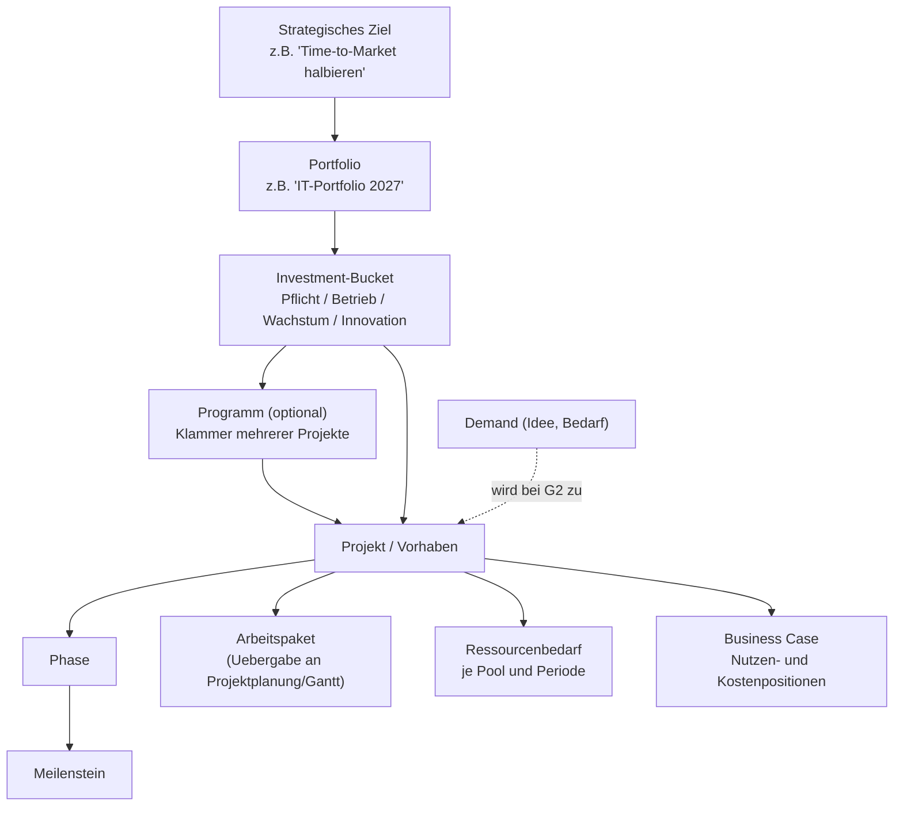
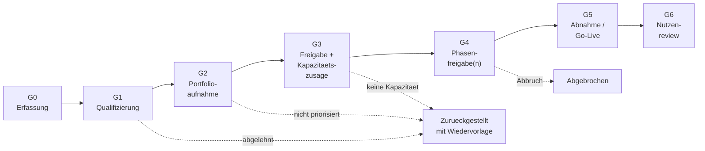
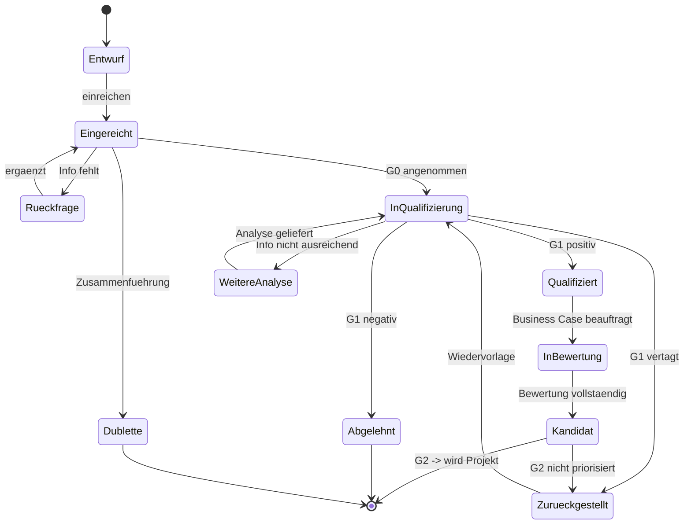
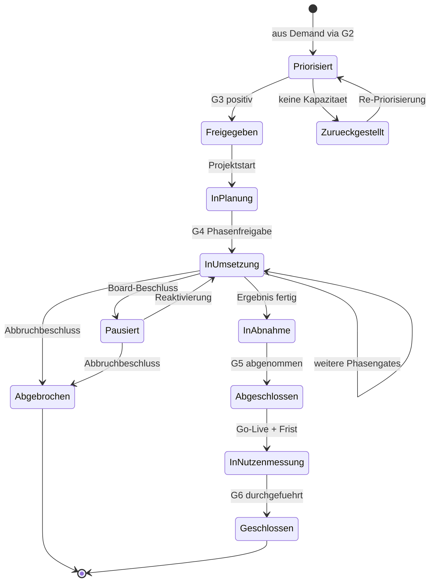
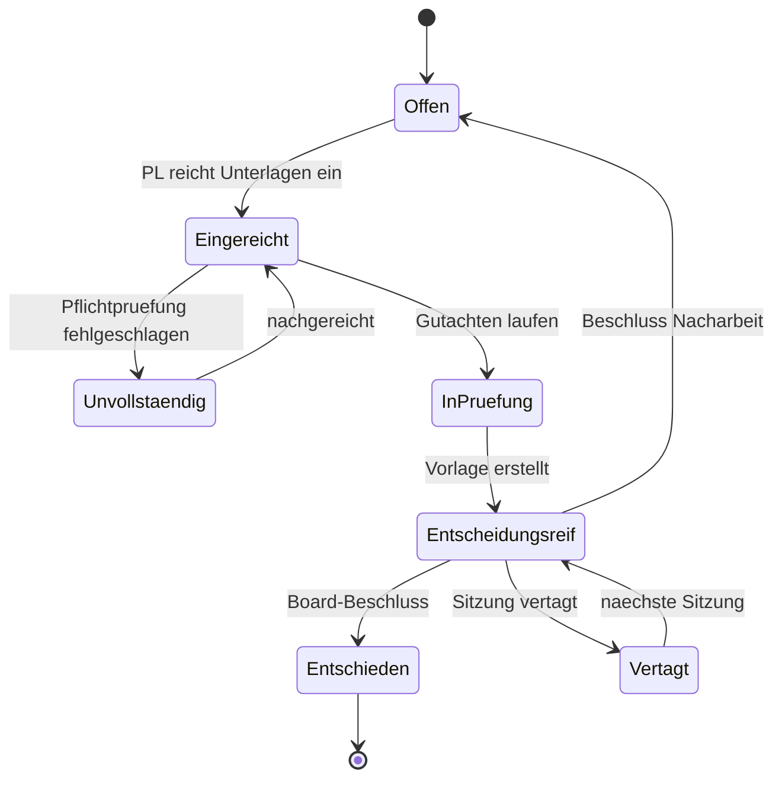
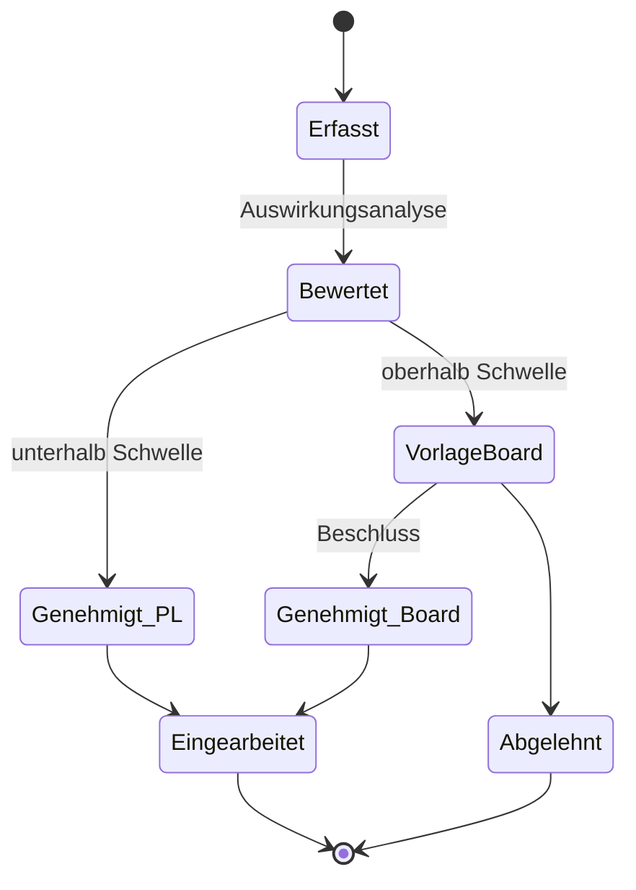
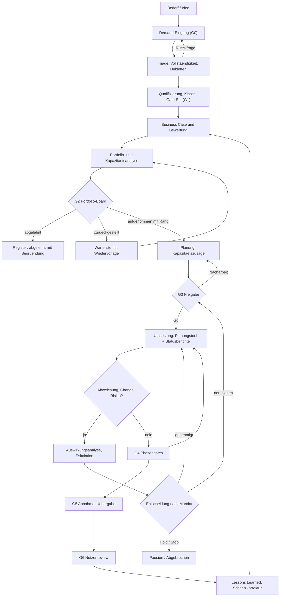

# 02 — Portfolio-Objekte und Lebenszyklus

## 1. Objekthierarchie

**Abgrenzung:** Die Governance-Ebene endet beim Arbeitspaket und beim Meilenstein. Alles
darunter — Vorgänge, Abhängigkeiten, Tagesplanung — gehört in die Projektplanung (Gantt oder ein
anderes Planungstool, angebunden über die Schnittstelle in Kapitel 07).
Die Schnittstelle ist bidirektional: Governance liefert Freigabe und Kapazitätszusage,
die Projektplanung liefert Termine, Fortschritt und den zeitlich verteilten Ressourcenbedarf zurück.

**Ergänzungen zur Hierarchie:**

- **Strategische Ziele** sind hierarchisch (Ziel → Teilziel) und versioniert. Ein Vorhaben kann
  auf **mehrere** Ziele einzahlen, jeweils mit Beitragsstärke (Kriterium N1, Kapitel 03). Damit
  werden Investitionsschwerpunkte und Ziele ohne Vorhaben sichtbar.
- **Programm** bündelt mehrere Projekte mit gemeinsamem Nutzen (entspricht der „Initiative“ in
  anderen Modellen). Ein Demand kann bei G2 in mehrere Projekte eines Programms münden.
- **Abhängigkeiten zwischen Vorhaben** (`enables`, `requires`, `shares_resource`) sind eigene
  Objekte — sie speisen den Enabler-Bonus (Kapitel 03) und die Szenarioanalyse (Kapitel 04).
- **Steuerungsgegenstand ist zunächst das Projekt.** Produkte, Daueraufgaben und Linien-Changes
  laufen nur als Kapazitätsabzug (Linienquote) bzw. als Klasse XS mit (Kapitel 01, 6.1).

## 2. Demand: der einzige Eingang

Jeder Bedarf betritt das System als **Demand**. Das Demand-Formular ist bewusst kurz — Hürden
am Eingang führen zu Schattenprojekten.

**Pflichtfelder bei Einreichung:**

| Feld | Zweck |
|---|---|
| Titel, Kurzbeschreibung | Identifikation |
| Antragsteller, Fachbereich | Zuordnung |
| Business Owner (vorgeschlagen) | Verantwortungszuordnung |
| Problem / Auslöser | *Was passiert, wenn wir nichts tun?* — wichtigstes Feld |
| Erwarteter Nutzen (qualitativ) | Grundlage der Grobbewertung |
| Gewünschter Zeitrahmen, Zwang (z. B. Gesetzesfrist) | Dringlichkeit |
| Kategorie-Vorschlag (Pflicht/Betrieb/Wachstum/Innovation) | Bucket-Zuordnung |
| Betroffene Systeme (Freitext oder Auswahl) | Vorab-Hinweis auf Engpassskills |

**Optional / später ergänzbar:** Grobschätzung Aufwand und Kosten, Abhängigkeiten, Alternativen.

**Antragstypen** (konfigurierbar): Pflicht/Regulatorik · Strategisch · Effizienz · Erhalt/Lifecycle ·
Innovation. Der Typ bestimmt die verlangten Zusatzfelder (z. B. Nachweis der Verpflichtung) und
den Bucket-Vorschlag. Formulare und Pflichtfelder sind je Typ konfigurierbar, aber die
Demand-Erfassung muss in **unter fünf Minuten** möglich bleiben.

**Unterstützung beim Eingang:**

- **Dublettenvorschlag** beim Tippen (Volltextsuche über Titel und Problembeschreibung offener und
  zurückgestellter Demands); ähnliche Demands lassen sich verknüpfen oder zusammenführen
- **Rückfragen** als Kommentarfaden am Demand, mit Status *Rückfrage* und Frist
- **Weitere Eingangskanäle** (Ticketsystem, E-Mail-Postfach) legen Demands im Status *Entwurf* an —
  Einreichung bleibt eine bewusste Handlung des Antragstellers

**Verbindliche Entscheidungscodes** am Ende von G0/G1:

| Code | Bedeutung | Folge |
|---|---|---|
| `angenommen` | weiter in die Qualifizierung bzw. Bewertung | Aufgabe Business Case |
| `weitere_analyse` | Entscheidung ohne zusätzliche Information nicht möglich | Auftrag mit Frist und Verantwortlichem |
| `zurueckgestellt` | bewusst vertagt | **Wiedervorlagedatum Pflicht** |
| `abgelehnt` | verbindlich nicht angenommen | **Begründung Pflicht**, bleibt im Register sichtbar |
| `dublette` | zusammengeführt mit einem anderen Demand | Verweis auf das führende Objekt |

## 3. Stage-Gate-Modell

### Gate-Steckbriefe

| Gate | Frage | Entscheider | Pflichtdaten (Eingangsbedingung) | Mögliche Beschlüsse |
|---|---|---|---|---|
| **G0 Erfassung** | Ist der Bedarf verständlich beschrieben? | PMO | Demand-Pflichtfelder | Angenommen · Rückfrage · Duplikat (Zusammenführung) |
| **G1 Qualifizierung** | Lohnt der Aufwand für einen Business Case? | PMO + Fachgutachter | Grobschätzung Aufwand, Kategorie, Ersteinschätzung Technik/Security | Qualifiziert · Abgelehnt · Zurückgestellt · Klasse XS/S → verkürzter Pfad |
| **G2 Portfolioaufnahme** | Ist das Vorhaben im Vergleich zu anderen wertvoll genug? | Portfolio-Board | vollständiger Business Case, Scoring aller Kriterien, Grob-Ressourcenbedarf je Pool, Risikobewertung | Aufgenommen mit Rang · Aufgenommen mit Auflagen · Zurückgestellt · Abgelehnt |
| **G3 Freigabe** | Können wir es *jetzt* starten? | Portfolio-Board (Kapazität: Ressourcen-Board) | Projektplan grob, harte Allokation der Engpasspools, benannter PL und Sponsor, Budget bestätigt | Freigegeben · Freigegeben mit Auflagen · Startverschiebung auf Datum X · Zurückgestellt |
| **G4 Phasenfreigabe** | Rechtfertigen die Erkenntnisse die nächste Investitionsstufe? | Portfolio-Board (bei Klasse M/L) | aktualisierter Business Case, Ist-Kosten, Restaufwand, Risikoliste, Ergebnisse der Vorphase | Fortsetzen · Fortsetzen mit Auflagen · Umfang ändern · Pausieren · Abbrechen |
| **G5 Abnahme / Go-Live** | Ist das Ergebnis übergabefähig? | Business Owner (mit Betrieb und Security) | Abnahmekriterien erfüllt, Betriebsübergabe, Dokumentation, Security-Freigabe | Abgenommen · Abgenommen mit Restpunkten · Abgelehnt |
| **G6 Nutzenreview** | Ist der versprochene Nutzen eingetreten? | Portfolio-Board (Vorlage PMO, Verantwortung Sponsor) | Ist-Werte je Nutzenposition, Ist-Gesamtkosten, Lessons Learned | Nutzen bestätigt · teilweise · verfehlt (+ Maßnahme) |

**Regel zu G6:** Der Review findet 6–12 Monate nach Go-Live statt und wird beim Beschluss von G3
terminiert und einem Verantwortlichen zugewiesen. Ohne diesen Termin verfällt der Business Case
zur unverbindlichen Absichtserklärung. Bei Nutzen, der später oder gestaffelt eintritt, sind
**mehrere Review-Zeitpunkte** je Nutzenposition möglich (Kapitel 03, 4).

### Einheitliche Beschlussarten an Gates

| Beschluss | Bedeutung | Folge im Tool |
|---|---|---|
| `freigegeben` (Go) | nächste Stufe beginnt | Statuswechsel, ggf. Budgettranche frei |
| `freigegeben_mit_auflagen` (Conditional Go) | Go, aber mit Bedingungen | Auflagenobjekte mit Verantwortlichem und Frist; blockierende Auflagen sperren das nächste Gate |
| `nacharbeit` (Rework) | Unterlagen oder Planung reichen nicht | Gate-Instanz zurück auf *Offen*, Nacharbeitsauftrag mit Frist |
| `zurueckgestellt` (Hold) | Entscheidung bewusst vertagt bzw. Vorhaben pausiert | Wiedervorlage- bzw. Wiederaufnahmedatum Pflicht |
| `abgelehnt` / `abgebrochen` (Stop) | Vorhaben endet | Allokationen werden freigegeben, Lessons Learned angefordert |

### Gestufte Budgetfreigabe

Budget wird nicht bei G2 vollständig freigegeben, sondern **in Tranchen je Gate**: G2 gibt das
Budget für die Planungsphase frei, G3 das für die erste Umsetzungsphase, jedes G4 die nächste
Tranche. So bleibt das Risiko je Entscheidung begrenzt, und Abbruch kostet nur die laufende Tranche.

### Gate-Sets je Vorhabenart

Gate-Definitionen sind konfigurierbar und werden zu **Gate-Sets** gebündelt, die einer
Vorhabensklasse und optional einem Antragstyp zugeordnet sind — etwa ein verkürztes Set für Klasse
S, ein Set mit zusätzlichem Compliance-Gate für regulatorische Vorhaben. Ein Vorhaben kennt sein
Gate-Set ab G1; ein Wechsel (z. B. durch Umklassifizierung) wird protokolliert.

### Zuordnung der Phasen

| Phase | abgeschlossen durch |
|---|---|
| Idee und Bedarf | G0 |
| Vorprüfung | G1 |
| Initiierung und Business Case | G2 |
| Planung und Freigabe | G3 |
| Umsetzung (eine oder mehrere Phasen) | G4 je Phase |
| Übergabe und Go-Live | G5 |
| Abschluss und Nutzenreview | G6 |

## 4. Statusautomaten

### 4.1 Demand

### 4.2 Projekt

**Wichtig für die Implementierung:** *Pausiert* ist ein expliziter, begründungspflichtiger Zustand
mit Wiederaufnahmedatum. Er verhindert das häufigste Portfolio-Problem — Projekte, die faktisch
stillstehen, formal aber laufen und Kapazität blockieren.

**Status, Eskalation und Beschluss sind getrennt:**

- Der **Status** beschreibt den Zustand des Vorhabens (Automat oben).
- **In Eskalation** ist *kein* Status, sondern ein Kennzeichen (`escalation_level` 0–3) — ein
  Projekt kann *InUmsetzung* und zugleich auf Stufe 2 eskaliert sein.
- Ein **Beschluss** (Decision) dokumentiert eine konkrete Governance-Entscheidung und löst ggf.
  einen Statuswechsel aus. Statuswechsel, die einen Beschluss erfordern (Freigabe, Pausieren,
  Abbruch), sind ohne verknüpfte Decision nicht möglich.

Für Berichte werden die Status zu wenigen **Portfoliophasen** verdichtet: *Antrag* (Demand-Status)
· *Geplant* (Priorisiert, Freigegeben) · *Aktiv* (InPlanung, InUmsetzung, InAbnahme) · *On Hold*
(Pausiert, Zurückgestellt) · *Beendet* (Abgeschlossen, Abgebrochen) · *Nutzenreview*
(InNutzenmessung).

### 4.3 Gate-Instanz

Beschlussarten je Gate-Instanz: `freigegeben` · `freigegeben_mit_auflagen` · `nacharbeit` ·
`zurueckgestellt` · `abgelehnt` · `abgebrochen` (siehe Abschnitt 3). Bei `freigegeben_mit_auflagen` entstehen zwingend
**Auflagenobjekte** mit Verantwortlichem und Frist; offene Auflagen blockieren das nächste Gate.

### 4.4 Change Request

Änderungen an Umfang, Termin, Budget oder Ressourcenbedarf laufen nicht formlos.

**Schwellenwerte (Beispiel, konfigurierbar):** Budget +10 % oder +50 T€ · Termin +1 Monat auf einen
Meilenstein mit externer Zusage · Ressourcenbedarf +15 % in einem Engpasspool · jede Änderung des
zugesagten Nutzens. Unterhalb → Lenkungsausschuss (bzw. PL bei Klasse S), oberhalb →
Portfolio-Board (Entscheidungsrechte-Matrix, Kapitel 01, 4.2).

**Auswirkungsanalyse (Pflicht):** Jeder Change Request beziffert die Auswirkung auf **Kosten, Termin,
Ressourcen je Pool, Risiko und Nutzen**. Bei Ressourcenänderungen in Engpasspools zeigt das Tool
zusätzlich die **Portfolioauswirkung**: welche anderen Vorhaben durch die Mehrbelastung verschoben
würden (Szenario, Kapitel 04, 5.1).

**Baselines:** Ein genehmigter Change Request erzeugt eine neue **Baseline-Version** von Scope,
Terminen, Budget und Nutzen (Re-Baselining). Frühere Baselines bleiben erhalten; Abweichungen werden
immer gegen die ursprüngliche **und** die aktuelle Baseline ausgewiesen — sonst lässt sich jede
Verzögerung durch Re-Baselining unsichtbar machen.

### 4.5 Statusbericht und Projektgesundheit

**Berichtskadenz:** monatlich für Klasse M/L, quartalsweise für S, Stichtag konfigurierbar. Der
Bericht ist aus der Vorperiode vorbefüllt; Termine, Fortschritt und Ist-Werte kommen, soweit
vorhanden, aus dem Planungstool und der Zeiterfassung.

Zwei getrennte Sichten (Prinzip P11):

| Sicht | Quelle | Inhalt |
|---|---|---|
| **Statusampel** (gemeldet) | Projektleitung | `rag_scope`, `rag_time`, `rag_cost`, `rag_risk` mit Kommentar, Prognose Endtermin und Kosten (Forecast at Completion) |
| **Health-Indikator** (berechnet) | System | Regeln über objektive Daten, z. B.: Meilenstein mit externer Zusage überfällig · Forecast > Budget + Toleranz · Statusbericht überfällig · blockierende Auflage überfällig · kritisches Risiko ohne Maßnahme · Ist-Aufwand weicht > 25 % vom Plan ab · Konflikt offen auf Stufe ≥ 2 |

Widerspricht die Meldung dem Indikator (z. B. Termin „grün“, aber Meilenstein überfällig), markiert
das Tool den Bericht und fordert eine Begründung an. Die Regeln und Schwellen des Health-Indikators
sind Konfiguration; jede Regel nennt ihre Datenquelle.

### 4.6 Risiken, Issues und Maßnahmen

- **Einheitliche Methodik:** Kategorien, Eintrittswahrscheinlichkeit 1–5, Auswirkung 1–5, Score,
  Risikoeigner, Maßnahmen mit Frist, **Restrisiko** nach Maßnahme
- **Issue** = eingetretenes Problem mit Schweregrad und Eskalationsstufe (dasselbe Stufenmodell wie
  bei Ressourcenkonflikten, Kapitel 01, 7)
- **Maßnahme** (Action) ist ein eigenes Objekt mit Verantwortlichem und Fälligkeit. Sie kann aus
  einem Risiko, einem Issue, einem Statusbericht oder einem Beschluss entstehen — so landen alle
  offenen To-dos der Governance in **einer** Nachverfolgung.
- **Schwellen** (z. B. Score ≥ 15 oder Auswirkung 5) erzeugen automatisch einen Eskalationshinweis
  an Lenkungsausschuss bzw. PMO; markierte Risiken (`escalated_to_portfolio`) erscheinen in der
  aggregierten **Portfolio-Risikosicht**
- **Verknüpfte Risiken:** Ein Risiko kann mehrere Vorhaben betreffen (z. B. Lieferantenausfall,
  Schlüsselperson im Engpasspool). Es wird dann einmal geführt und den Vorhaben zugeordnet, statt in
  jedem Projekt neu und unabhängig bewertet zu werden.

## 5. Regelwerk für Statusübergänge (Tool-Logik)

| Übergang | Vorbedingung, die das Tool prüft |
|---|---|
| Demand → *Eingereicht* | alle Pflichtfelder aus Abschnitt 2 gefüllt |
| Demand → *Kandidat* | Business Case vorhanden, alle Pflicht-Scoring-Kriterien bewertet, Ressourcenbedarf je Pool erfasst |
| Projekt → *Freigegeben* | Sponsor und PL benannt, Hard-Allokation für alle als Engpass markierten Pools vorhanden, Budget zugewiesen, keine offene blockierende Auflage |
| Projekt → *InUmsetzung* | mindestens ein Phasengate G4 mit Beschluss `freigegeben` |
| Projekt → *Abgeschlossen* | Gate G5 entschieden, alle Restpunkte terminiert, Allokationen beendet (Kapazität wird freigegeben) |
| Projekt → *Geschlossen* | Gate G6 entschieden, Ist-Nutzen je Position erfasst |
| Gate → *Entschieden* | Quorum erfüllt, Stimmen erfasst, Begründungstext vorhanden, Entscheider laut Entscheidungsrechte-Matrix zuständig |
| Projekt → *Pausiert* / *Abgebrochen* | Decision mit Begründung vorhanden; bei *Pausiert* Wiederaufnahmedatum |
| Change Request → *Genehmigt* | Auswirkungsanalyse vollständig, genehmigende Instanz passt zur Schwelle |

## 6. End-to-End-Ablauf im Überblick

## 7. Priorisierung und Rangliste

Aus G2 entsteht kein binäres Ja/Nein, sondern ein **Rang innerhalb des Buckets**. Die Rangliste ist
das zentrale Steuerungsartefakt:

- Rang wird bei jedem Portfolio-Board neu bestimmt (Score + Board-Korrektur)
- Ein manuelles Übersteuern des Score-Rangs ist erlaubt, aber begründungspflichtig und wird als
  Delta sichtbar gemacht („Board-Korrektur: +4 Ränge, Begründung: …")
- Die Rangliste wird gegen die Kapazitätslinie geschnitten: alles oberhalb der Linie ist
  startfähig, alles darunter wartet (siehe Kapitel 04, Abschnitt 5)
