# 05 — Datenmodell

Implementierungsgrundlage. Technologieneutral formuliert; Typangaben sind Hinweise, keine
Festlegung auf ein DBMS. Die Abbildung auf Nextcloud (Benutzer-IDs, Tabellenpräfixe,
Namensgrenzen) steht in Kapitel 07, 6.

## 1. Überblick

```mermaid
erDiagram
    STRATEGIC_OBJECTIVE ||--o{ STRATEGIC_OBJECTIVE : "Teilziel von"
    STRATEGIC_OBJECTIVE ||--o{ PROJECT_OBJECTIVE : ""
    PROJECT ||--o{ PROJECT_OBJECTIVE : "zahlt ein auf"
    GOVERNANCE_BODY ||--o{ BOARD_SESSION : tagt
    GOVERNANCE_BODY ||--o{ DECISION_RIGHT : "ist befugt fuer"
    GATE_SET ||--o{ GATE_DEFINITION : buendelt
    PROJECT ||--o{ BASELINE : "hat Versionen"
    PROJECT ||--o{ BUDGET_TRANCHE : "erhaelt"
    PROJECT ||--o{ ACTION : "hat offene"
    PROJECT ||--o{ PLANNING_LINK : "geplant in"
    SCENARIO ||--o{ SCENARIO_CHANGE : enthaelt
    PORTFOLIO ||--o{ BUCKET : gliedert
    BUCKET ||--o{ PROJECT : enthaelt
    PROGRAM ||--o{ PROJECT : klammert
    DEMAND ||--o| PROJECT : "wird zu"
    PROJECT ||--o{ PROJECT_PHASE : hat
    PROJECT_PHASE ||--o{ MILESTONE : hat
    PROJECT ||--|| BUSINESS_CASE : hat
    BUSINESS_CASE ||--o{ BENEFIT_ITEM : enthaelt
    BUSINESS_CASE ||--o{ COST_ITEM : enthaelt
    PROJECT ||--o{ ASSESSMENT : bewertet_durch
    ASSESSMENT ||--o{ CRITERION_SCORE : besteht_aus
    CRITERION_SET ||--o{ CRITERION : definiert
    CRITERION ||--o{ CRITERION_SCORE : bewertet_in
    CRITERION ||--o{ SCALE_ANCHOR : hat
    PROJECT ||--o{ GATE_INSTANCE : durchlaeuft
    GATE_DEFINITION ||--o{ GATE_INSTANCE : instanziiert
    GATE_INSTANCE ||--|| DECISION : ergibt
    DECISION ||--o{ VOTE : besteht_aus
    DECISION ||--o{ CONDITION : erzeugt
    BOARD_SESSION ||--o{ GATE_INSTANCE : behandelt
    BOARD_SESSION ||--o{ DECISION : protokolliert
    PROJECT ||--o{ RESOURCE_DEMAND : fordert
    RESOURCE_POOL ||--o{ RESOURCE_DEMAND : betrifft
    RESOURCE_POOL ||--o{ POOL_CAPACITY : hat
    RESOURCE_DEMAND ||--o{ ALLOCATION : fuehrt_zu
    RESOURCE_POOL ||--o{ ALLOCATION : bindet
    PROJECT ||--o{ STATUS_REPORT : berichtet
    PROJECT ||--o{ RISK_PROJECT : ""
    RISK ||--o{ RISK_PROJECT : betrifft
    PROJECT ||--o{ ISSUE : hat
    DECISION ||--o{ ACTION : erzeugt
    PROJECT ||--o{ CHANGE_REQUEST : hat
    PROJECT ||--o{ DEPENDENCY : "haengt ab von"
    PROJECT ||--o{ BENEFIT_REVIEW : nachgewiesen_in
    PERSON ||--o{ ROLE_ASSIGNMENT : hat
    ORG_UNIT ||--o{ PERSON : beschaeftigt
```

## 2. Stammdaten

### PERSON
| Feld | Typ | Bemerkung |
|---|---|---|
| id | UUID | |
| external_id | String | Kopplung an Verzeichnisdienst (LDAP/OIDC-`sub`) |
| display_name, email | String | |
| org_unit_id | FK | |
| is_active | Bool | |

### ORG_UNIT
`id`, `name`, `parent_id` (Hierarchie), `cost_center`, `head_person_id`

### ROLE_ASSIGNMENT
| Feld | Typ | Bemerkung |
|---|---|---|
| person_id | FK | |
| role | Enum | `requestor`, `sponsor`, `project_manager`, `pool_manager`, `portfolio_manager`, `board_member`, `steering_member`, `benefit_owner`, `reviewer`, `controller`, `auditor`, `data_owner`, `viewer`, `admin` |
| scope_type | Enum | `global`, `portfolio`, `bucket`, `program`, `project`, `pool`, `org_unit`, `body` |
| scope_id | UUID | null bei `global` |
| valid_from, valid_to | Date | Vertretungsregelungen |
| deputy_for_id | FK self | gesetzt, wenn die Zuweisung eine Stellvertretung ist |

> Rollen sind **kontextgebunden**. Jemand kann Sponsor eines Projekts, Board-Mitglied im
> Portfolio und Viewer anderswo sein. Ein globales Rollenfeld an der Person reicht nicht.

### STRATEGIC_OBJECTIVE
`id`, `parent_id` (Zielhierarchie), `code`, `title`, `description`, `version`, `valid_from`, `valid_to`, `owner_person_id`, `target_metric`, `target_value`

Eine neue Strategieversion legt neue Zielobjekte an (`valid_from`), alte bleiben mit `valid_to`
erhalten, damit frühere Bewertungen erklärbar bleiben.

### PROJECT_OBJECTIVE
`project_id`, `objective_id`, `contribution` (0|1|3|5|8, entspricht N1), `rationale`

### GOVERNANCE_BODY
`id`, `code`, `name`, `type` (`executive`|`portfolio_board`|`resource_board`|`architecture_board`|`steering_committee`|`pmo`), `portfolio_id`, `project_id` (bei Lenkungsausschuss), `chair_person_id`, `default_quorum` (JSON)

Mitglieder sind `ROLE_ASSIGNMENT` mit `scope_type = body`.

### DECISION_RIGHT
| Feld | Typ | Bemerkung |
|---|---|---|
| id, portfolio_id | | Matrix je Portfolio (Mandantenfähigkeit) |
| decision_type | Enum | `gate`, `priority`, `allocation_hard`, `budget_tranche`, `budget_increase`, `change_scope`, `change_time`, `pause`, `cancel`, `benefit_review` |
| gate_code, project_classes | | Einschränkung, optional |
| threshold | JSON | z. B. `{"delta_budget_pct":10,"delta_budget_abs":50000}` |
| body_id | FK | entscheidendes Gremium |
| quorum_rule | JSON | überschreibt `default_quorum` |
| valid_from, valid_to | | versioniert wie der Kriterienkatalog |

Die Auswahl der zuständigen Instanz ist eine reine Funktion `(decision_type, Projekt, Delta) → body`.
Sie wird beim Anlegen eines Antrags ausgewertet und das Ergebnis am Antrag gespeichert.

## 3. Portfolio-Struktur

### PORTFOLIO
`id`, `name`, `fiscal_year`, `status` (`planning`|`active`|`closed`), `owner_person_id`, `org_unit_id`, `criterion_set_id`

Das Portfolio ist zugleich die **Mandantengrenze**: Kriterienkatalog, Entscheidungsrechte,
Gate-Sets und Sichtbarkeit hängen daran (Kapitel 06, 7).

### BUCKET
| Feld | Typ | Bemerkung |
|---|---|---|
| id, portfolio_id | | |
| code | Enum | `A_mandatory`, `B_lifecycle`, `C_growth`, `D_innovation` (erweiterbar) |
| name, description | | |
| target_share_pct | Decimal | Zielquote der Kapazität |
| target_budget | Decimal | optional |

### PROGRAM
`id`, `portfolio_id`, `name`, `program_manager_id`, `status`, `description`

## 4. Demand und Projekt

### DEMAND
| Feld | Typ | Bemerkung |
|---|---|---|
| id, key | | menschenlesbarer Schlüssel, z. B. `DEM-2026-0147` |
| title, description | | |
| problem_statement | Text | „Was passiert, wenn wir nichts tun?" — Pflicht |
| expected_benefit | Text | |
| requestor_id, sponsor_id, org_unit_id | FK | |
| proposed_bucket | Enum | |
| demand_type | Enum | `mandatory`, `strategic`, `efficiency`, `lifecycle`, `innovation` (konfigurierbar) |
| desired_timeframe | Text/Date | |
| compulsion_type | Enum | `none`, `legal`, `contractual`, `audit`, `security`, `eol` |
| compulsion_reference | String | Gesetzesstelle, Vertragsnummer, Finding-ID |
| compulsion_deadline | Date | |
| affected_systems | Array/Relation | |
| status | Enum | Statusautomat Kapitel 02, 4.1 |
| duplicate_of_id | FK self | bei Zusammenführung |
| triage_code | Enum | `angenommen`, `weitere_analyse`, `zurueckgestellt`, `abgelehnt`, `dublette` |
| triage_reason | Text | Pflicht bei `abgelehnt` |
| resubmission_date | Date | Pflicht bei `zurueckgestellt` |
| intake_channel | Enum | `form`, `ticket`, `mail`, `api` |
| project_id | FK | gesetzt nach G2 |
| created_at, submitted_at | Timestamp | Basis für Durchlaufzeit-KPI |

### PROJECT
| Feld | Typ | Bemerkung |
|---|---|---|
| id, key | | `PRJ-2026-0031` |
| demand_id, portfolio_id, bucket_id, program_id | FK | |
| title, description | | |
| project_class | Enum | `XS`,`S`,`M`,`L` — abgeleitet, überschreibbar |
| class_override_reason | Text | |
| gate_set_id | FK | ab G1 festgelegt |
| sponsor_id, project_manager_id | FK | |
| status | Enum | Statusautomat Kapitel 02, 4.2 |
| status_reason | Text | Pflicht bei `Pausiert`, `Abgebrochen`, `Zurueckgestellt` |
| resume_date | Date | Pflicht bei `Pausiert` |
| planned_start, planned_end, actual_start, actual_end | Date | |
| latest_start | Date | spätester Start aus Termindruck — Input für Kapazitätsschnitt |
| budget_frame, budget_approved, budget_committed, cost_actual, forecast_at_completion | Decimal | Kapitel 03, 7.2; `budget_approved` = Summe freigegebener Tranchen |
| current_score, current_rank | Decimal/Int | denormalisiert aus jüngstem Assessment |
| rank_override, override_reason, override_by, override_at | | Board-Korrektur |
| rag_scope, rag_time, rag_cost, rag_risk | Enum | `green`,`yellow`,`red` — gemeldet, aus jüngstem Statusbericht |
| health | Enum | `green`,`yellow`,`red` — **berechnet** (Kapitel 02, 4.5) |
| health_findings | JSON | ausgelöste Health-Regeln mit Datenquelle |
| escalation_level | Int | 0–3, Kennzeichen statt Status |
| current_baseline_id | FK | |
| benefit_review_due | Date | wird bei G3 gesetzt |
| strategic_objectives | M:N | über PROJECT_OBJECTIVE |

### PROJECT_PHASE
`id`, `project_id`, `name`, `sequence`, `planned_start`, `planned_end`, `status`, `gate_instance_id`

### MILESTONE
`id`, `project_id`, `phase_id`, `name`, `due_date`, `baseline_date`, `forecast_date`, `actual_date`, `is_external_commitment` (Bool), `status`, `source` (`manual`|`planning`), `external_ref` (Meilenstein im Planungstool)

Nur **governance-relevante** Meilensteine (Gate-Termine, externe Zusagen) werden hier geführt; die
übrigen bleiben im Planungstool.

### BASELINE
`id`, `project_id`, `version`, `created_at`, `decision_id` (genehmigender Beschluss), `scope_summary`, `planned_start`, `planned_end`, `budget_frame`, `milestones` (JSON-Schnappschuss), `benefit_summary`, `resource_demand` (JSON je Pool/Periode)

Unveränderlich; Version 1 entsteht bei G3, jede weitere durch einen genehmigten Change Request.

### BUDGET_TRANCHE
`id`, `project_id`, `gate_instance_id`, `amount`, `fiscal_year`, `released_at`, `decision_id`

### PLANNING_LINK
`id`, `project_id`, `provider` (z. B. `gantt`, `openproject`, `deck`, `mspdi`), `external_id`, `external_url`, `linked_at`, `last_sync_at`, `sync_status`, `field_ownership` (JSON, Kapitel 07, 3)

### DEPENDENCY
| Feld | Typ | Bemerkung |
|---|---|---|
| id | | |
| from_project_id, to_project_id | FK | |
| type | Enum | `enables` (Enabler-Bonus, Kapitel 03), `requires`, `shares_resource`, `conflicts_with` |
| criticality | Enum | `low`,`medium`,`high`,`blocking` |
| description | Text | |

## 5. Bewertung

### CRITERION_SET
`id`, `version`, `valid_from`, `valid_to`, `status` (`draft`|`active`|`retired`), `created_by`

### CRITERION
`id`, `criterion_set_id`, `code` (z. B. `N1`), `name`, `dimension` (`benefit`|`urgency`|`effort`|`risk`), `weight_pct`, `is_mandatory`, `sequence`, `help_text`

### SCALE_ANCHOR
`id`, `criterion_id`, `value` (0|1|3|5|8), `anchor_text`, `example`

### ASSESSMENT
| Feld | Typ | Bemerkung |
|---|---|---|
| id, project_id (oder demand_id) | | |
| criterion_set_id | FK | Version, gegen die bewertet wurde |
| assessor_id, assessor_role | | `self`, `pmo`, `architecture`, `security`, `controlling`, `pool_manager` |
| assessed_at | Timestamp | |
| benefit_value, urgency_value, effort_value, risk_value | Decimal | berechnet |
| value_density | Decimal | Formel Kapitel 03, 3 |
| estimate_quality | Enum | `rough`,`plausibilised`,`planned` |
| is_current | Bool | genau eine je Projekt und Rolle |
| **unveränderlich nach Anlage** | | Korrektur = neues Assessment |

### CRITERION_SCORE
`id`, `assessment_id`, `criterion_id`, `value`, `rationale` (Text, Pflicht bei Werten 5 und 8)

## 6. Business Case

### BUSINESS_CASE
`id`, `project_id`, `version`, `created_at`, `created_by`, `status` (`draft`|`submitted`|`approved`|`superseded`), `frozen_for_gate_instance_id`, `discount_rate_pct`, `horizon_years`, `npv`, `payback_months`, `tco_total`

### ASSUMPTION
`id`, `business_case_id`, `text`, `rationale`, `owner_person_id`, `review_at`, `status` (`valid`|`questioned`|`invalid`)

### BENEFIT_ITEM
| Feld | Typ | Bemerkung |
|---|---|---|
| id, business_case_id | | |
| type | Enum | `cost_reduction`,`capacity_gain`,`revenue`,`cost_avoidance`,`qualitative` |
| description | Text | |
| amount_per_year, currency, unit | | bei `capacity_gain` z. B. FTE |
| start_period, end_period | | ab wann der Nutzen fließt |
| metric_name, baseline_value, baseline_date, target_value | | **Pflicht** — ohne Baseline kein G6 |
| measurement_method | Text | wie wird gemessen |
| owner_person_id | FK | **Pflicht** |
| probability_pct | Int | bei `cost_avoidance`: Eintrittswahrscheinlichkeit |
| forecast_value | Decimal | laufende Nutzenprognose des Benefit Owners |
| realization_status | Enum | `not_started`,`on_track`,`at_risk`,`realized`,`missed` |
| review_dates | Array Date | einer oder mehrere Messzeitpunkte |

### COST_ITEM
`id`, `business_case_id`, `type` (`internal_effort`|`external_service`|`license`|`hardware`|`cloud`|`other`), `capex_opex`, `description`, `amount`, `period`, `pool_id` (bei internem Aufwand), `person_days`

## 7. Gates und Entscheidungen

### GATE_SET
`id`, `portfolio_id`, `name`, `applies_to_classes` (Array), `applies_to_demand_types` (Array, optional), `version`, `valid_from`

### GATE_DEFINITION
| Feld | Typ | Bemerkung |
|---|---|---|
| id, gate_set_id, code | | `G0`..`G6`, ggf. Zusatzgates |
| name, purpose | | |
| decider_body | Enum | `pmo`,`resource_board`,`portfolio_board`,`sponsor`,`architecture_board` |
| applies_to_classes | Array | z. B. `["M","L"]` |
| required_fields | JSON | maschinenlesbare Vollständigkeitsprüfung (Prinzip P2) |
| quorum_rule | JSON | z. B. `{"min_voters":4,"required_roles":["cio"]}` |

### GATE_INSTANCE
`id`, `project_id`, `gate_definition_id`, `phase_id` (bei G4), `status` (Kapitel 02, 4.3), `submitted_at`, `submitted_by`, `board_session_id`, `decision_id`, `completeness_check` (JSON: Ergebnis der Pflichtfeldprüfung)

### BOARD_SESSION
`id`, `body_id` (FK GOVERNANCE_BODY), `scheduled_at`, `location`, `chair_person_id`, `status` (`planned`|`agenda_final`|`held`|`minuted`), `minutes_document_id`, `calendar_event_uid`, `talk_room_token`

### DECISION
| Feld | Typ | Bemerkung |
|---|---|---|
| id | | |
| gate_instance_id / change_request_id / conflict_id / scenario_id | FK | polymorpher Anlass |
| decision_type | Enum | wie DECISION_RIGHT |
| decision_right_id, body_id | FK | Mandat, auf dessen Grundlage entschieden wurde |
| board_session_id | FK | null bei Umlaufverfahren |
| decided_at | Timestamp | |
| outcome | Enum | `approved`,`approved_with_conditions`,`rework`,`deferred`,`rejected`,`cancelled` |
| options_presented | JSON | Entscheidungsoptionen der Vorlage |
| recommendation | Text | Empfehlung des PMO bzw. der Vorbereitenden |
| rationale | Text | **Pflicht** |
| alternatives_considered | Text | |
| resubmission_date | Date | Pflicht bei `deferred` |
| valid_until | Date | Freigaben können verfallen |
| **immutable** | | nach Anlage nicht änderbar; Korrektur = neue Decision mit `supersedes_id` |

### VOTE
`id`, `decision_id`, `person_id`, `on_behalf_of_id` (Stellvertretung), `vote` (`yes`|`no`|`abstain`), `abstained_conflict_of_interest` (Bool), `comment`

### CONDITION (Auflage)
`id`, `decision_id`, `project_id`, `description`, `owner_person_id`, `due_date`, `status` (`open`|`fulfilled`|`waived`), `is_blocking` (blockiert nächstes Gate), `fulfilled_at`, `evidence`

### ACTION (Maßnahme)
`id`, `origin_type` (`decision`|`risk`|`issue`|`status_report`|`benefit_review`|`conflict`), `origin_id`, `project_id`, `title`, `owner_person_id`, `due_date`, `status` (`open`|`done`|`cancelled`), `escalated` (Bool)

Auflagen sind die gate-blockierende Sonderform; alle übrigen To-dos der Governance sind Actions und
landen in einer gemeinsamen Nachverfolgung.

## 8. Ressourcen

### RESOURCE_POOL
| Feld | Typ | Bemerkung |
|---|---|---|
| id, code, name | | |
| org_unit_id, manager_person_id | FK | |
| is_bottleneck | Bool | steuert Gate-Härte (Kapitel 04, 1) |
| key_person_dependency | Int | Anzahl Wissensträger, null = unkritisch |
| skills | Array | Schlagworte für die Substitutionssuche |
| cost_rate_per_day | Decimal | Verrechnungssatz (Kapitel 03, 7.2) |
| pool_type | Enum | `internal`,`external`,`business` |
| wip_limit | Int | |
| absence_rate_pct, line_work_rate_pct, overhead_rate_pct, emergency_reserve_pct | Decimal | Kapitel 04, 2 |
| lead_time_weeks | Int | bei `external` |

### POOL_CAPACITY
`id`, `pool_id`, `period` (YYYY-MM oder YYYY-Qn), `fte`, `working_days`, `gross_days`, `net_days`, `project_days` (berechnet), `manual_override_days`, `override_reason`

### RESOURCE_DEMAND
`id`, `project_id`, `pool_id`, `period`, `person_days`, `source` (`estimate`|`plan`|`planning_link`), `planning_link_id`, `estimate_quality`, `created_at`

### ROLE_POOL_MAPPING
`id`, `provider`, `external_role_ref` (z. B. Rollen-Ressource in Gantt), `pool_id`

Übersetzt Bedarf aus dem Planungstool (Rolle × Periode) in Pool-Bedarf (Kapitel 07, 4).

### ALLOCATION
| Feld | Typ | Bemerkung |
|---|---|---|
| id, project_id, pool_id, period | | |
| person_days | Decimal | |
| level | Enum | `requested`,`soft`,`hard`,`actual` |
| granted_by, granted_at | | |
| expires_at | Date | Verfall von `soft` |
| decision_id | FK | bei `hard`: verweist auf Board-Beschluss |
| note | Text | |

**Integritätsregel (Datenbank- oder Service-Ebene):**
`Σ ALLOCATION.person_days (level='hard') je (pool_id, period) ≤ POOL_CAPACITY.project_days`
— Verletzung wird abgewiesen, nicht nur gewarnt.

## 9. Steuerung und Nachverfolgung

### STATUS_REPORT
`id`, `project_id`, `period`, `reported_by`, `reported_at`, `rag_scope`, `rag_time`, `rag_cost`, `rag_risk`, `rag_comment`, `progress_pct`, `achievements`, `next_steps`, `impediments`, `cost_actual_to_date`, `effort_actual_to_date`, `forecast_end_date`, `forecast_cost`, `health_snapshot` (JSON: Health-Indikator zum Stichtag), `contradiction_reason` (Pflicht, wenn Meldung und Health widersprechen), `prefilled_from` (Planungs-/Zeiterfassungsdaten mit Herkunft)

### RISK
`id`, `portfolio_id`, `title`, `description`, `category`, `probability` (1–5), `impact` (1–5), `score` (berechnet), `mitigation`, `residual_probability`, `residual_impact`, `residual_score`, `owner_person_id`, `status`, `due_date`, `escalated_to_portfolio` (Bool)

### RISK_PROJECT
`risk_id`, `project_id`, `is_primary` — ein Risiko kann mehrere Vorhaben betreffen (Kapitel 02, 4.6)

### ISSUE
`id`, `project_id`, `title`, `description`, `severity`, `owner_person_id`, `status`, `due_date`, `escalation_level` (0–3, Kapitel 01, 7)

### CHANGE_REQUEST
`id`, `project_id`, `title`, `description`, `requested_by`, `type` (`scope`|`time`|`cost`|`resource`|`benefit`), `delta_budget`, `delta_end_date_days`, `delta_person_days` (JSON je Pool), `delta_risk`, `delta_benefit`, `impact_analysis`, `portfolio_impact` (JSON: Ergebnis des Szenariovergleichs), `status` (Kapitel 02, 4.4), `responsible_body_id` (aus DECISION_RIGHT berechnet), `decision_id`, `resulting_baseline_id`

### CONFLICT
| Feld | Typ | Bemerkung |
|---|---|---|
| id | | |
| type | Enum | `overbooking`,`uncovered_demand`,`wip_exceeded`,`priority_inversion`,`bottleneck_peak`,`zombie_project` |
| pool_id, period | | |
| project_ids | Array | beteiligte Vorhaben |
| detected_at, detected_by | | `system` bei automatischer Erkennung |
| escalation_level | Int | 1–3 |
| status | Enum | `open`,`in_negotiation`,`escalated`,`resolved`,`accepted` |
| resolution_option | Enum | `sequenced`,`scope_cut`,`substituted`,`external`,`paused`,`deprioritised` (Prüfreihenfolge Kapitel 01, 7) |
| rejected_options | JSON | warum die vorrangigen Optionen verworfen wurden |
| decision_id | FK | |

### BENEFIT_REVIEW
`id`, `project_id`, `benefit_item_id`, `review_date`, `actual_value`, `achievement_pct`, `assessment` (`achieved`|`partial`|`missed`), `explanation`, `lessons_learned`, `follow_up_action`, `reviewed_by`

### SCENARIO
`id`, `portfolio_id`, `name`, `created_by`, `created_at`, `base_snapshot_at`, `status` (`draft`|`presented`|`adopted`|`discarded`), `result` (JSON: Startplan, verdrängte Vorhaben, Bucket-Balance)

### SCENARIO_CHANGE
`id`, `scenario_id`, `change_type` (`add_project`|`remove_project`|`pause`|`shift_start`|`change_rank`|`change_capacity`|`change_budget`|`change_weights`|`change_quota`), `target_ref`, `parameters` (JSON)

Szenarien arbeiten auf Kopien; sie verändern nie Allokationen oder Ränge. Ein angenommenes Szenario
erzeugt Actions, die die Änderungen regulär umsetzen.

### KPI_DEFINITION
`id`, `code`, `name`, `definition`, `formula`, `data_source`, `refresh_interval`, `owner_person_id`, `threshold_green`, `threshold_red`, `direction` (`up`|`down`|`band`), `audience` (Rollen)

## 10. Querschnitt

### AUDIT_LOG
`id`, `entity_type`, `entity_id`, `action` (`create`|`update`|`status_change`|`decision`|`delete`), `field_changes` (JSON alt/neu), `person_id`, `timestamp`, `ip`, `comment`

Pflichtprotokollierung für: alle Statusübergänge, alle Decisions und Votes, alle
`hard`-Allokationen, alle Score- und Rang-Überschreibungen, alle Änderungen an
Kriterienkatalog und Bucket-Quoten.

### Weitere
- **ATTACHMENT** — `id`, `entity_type`, `entity_id`, `filename`, `storage_ref`, `uploaded_by`, `classification` (`public`|`internal`|`confidential`)
- **COMMENT** — `id`, `entity_type`, `entity_id`, `person_id`, `text`, `visibility` (`all`|`board_only`|`pmo_only`), `parent_id`
- **NOTIFICATION** — `id`, `person_id`, `event_type`, `entity_ref`, `channel`, `sent_at`, `read_at`
- **CONFIG** — `key`, `value` (JSON), `scope`, `valid_from` — für Schwellenwerte, Quoten, Kadenzen

### Datenherkunft und Daten-Owner

Jedes Feld, das aus einem Umsystem befüllt werden kann, führt seine **Herkunft** mit
(`manual` oder Provider-Kennung + Zeitpunkt der letzten Übernahme), auf Objekt- oder Feldebene.
Die Oberfläche zeigt sie an; Berichte weisen den Anteil manueller Daten aus.

| Objekttyp | Daten-Owner (Beispiel) | Aktualisierungspflicht |
|---|---|---|
| Demand | Antragsteller | bis G2 |
| Business Case, Nutzenpositionen | Sponsor / Benefit Owner | je Gate, nach Go-Live je Review |
| Projekt-Stammdaten, Statusbericht, Risiken | Projektleitung | je Berichtsperiode |
| Pool-Kapazität, Quoten | Pool-Manager | monatlich bzw. jährlich |
| Kriterienkatalog, Gate-Sets, Entscheidungsrechte, KPI-Definitionen | PMO | bei Änderung, Freigabe durch Board |
| Strategische Ziele | Geschäftsführung (gepflegt durch PMO) | jährlich |

Das Datenqualitäts-Cockpit (Kapitel 06) misst gegen diese Tabelle.

## 11. Historisierung — bewusste Entwurfsentscheidung

| Objekt | Verfahren | Grund |
|---|---|---|
| ASSESSMENT, BUSINESS_CASE | **Versionierung** — neues Objekt, altes bleibt | Entwicklung der Einschätzung ist selbst eine Information |
| DECISION, VOTE | **Unveränderlich** — Korrektur nur via `supersedes_id` | Rechts- und Revisionssicherheit |
| ALLOCATION | **Periodenbezogen + Audit-Log** | Nachvollziehbarkeit von Zusagenrücknahmen |
| PROJECT, DEMAND | **Aktueller Stand + Audit-Log** | sonst wird jede Abfrage teuer |
| POOL_CAPACITY | **Periodenbezogen**, Planwerte eingefroren beim Portfolio-Board | Soll/Ist-Vergleich |
| CRITERION_SET | **Versioniert, Assessments referenzieren die Version** | historische Ränge müssen erklärbar bleiben |
| DECISION_RIGHT, GATE_SET, STRATEGIC_OBJECTIVE | **Versioniert** (`valid_from`/`valid_to`) | Beschlüsse müssen gegen das damals gültige Mandat prüfbar sein |
| BASELINE | **Unveränderliche Versionen** | Abweichung gegen ursprüngliche und aktuelle Baseline |
| Portfolio-Rangliste | **Schnappschuss je Board-Sitzung** | „Wie sah die Rangliste am Tag der Entscheidung aus?“ |

## 12. Abgeleitete Sichten (Views / Materialisierungen)

| View | Inhalt | Verwendung |
|---|---|---|
| `v_pool_utilisation` | Pool × Periode: Kapazität, soft, hard, actual, Auslastung % | Heatmap, Konflikterkennung |
| `v_portfolio_ranking` | Projekt, Bucket, Score, Rang, Override, startfähig ab | Board-Vorlage |
| `v_project_dashboard` | Projekt + jüngster Status + RAG + offene Auflagen + Konflikte | PL- und Board-Sicht |
| `v_decision_log` | alle Decisions chronologisch mit Anlass und Begründung | Revision, Transparenz |
| `v_benefit_tracking` | zugesagter vs. realisierter Nutzen je Projekt und Bucket | G6, Lernschleife |
| `v_bucket_balance` | Ist- vs. Zielquote der Kapazität je Bucket | Portfolio-Steuerung |
| `v_open_demand` | zurückgestellte, positiv bewertete Vorhaben mit PT-Bedarf | Argumentation Kapazitätsausbau |
| `v_objective_coverage` | Ziel × Vorhaben × Kapazität/Budget | strategische Abdeckung, Ziele ohne Vorhaben |
| `v_portfolio_risks` | eskalierte und projektübergreifende Risiken mit Score und Restrisiko | Portfolio-Risikosicht |
| `v_open_actions` | offene Actions und Conditions nach Fälligkeit, Owner, Herkunft | Beschluss- und Maßnahmenverfolgung |
| `v_financials` | Projekt × Periode: Rahmen, Tranchen, gebunden, Ist, FAC, Abweichung | Finanzsicht, Bucket-Budget |
