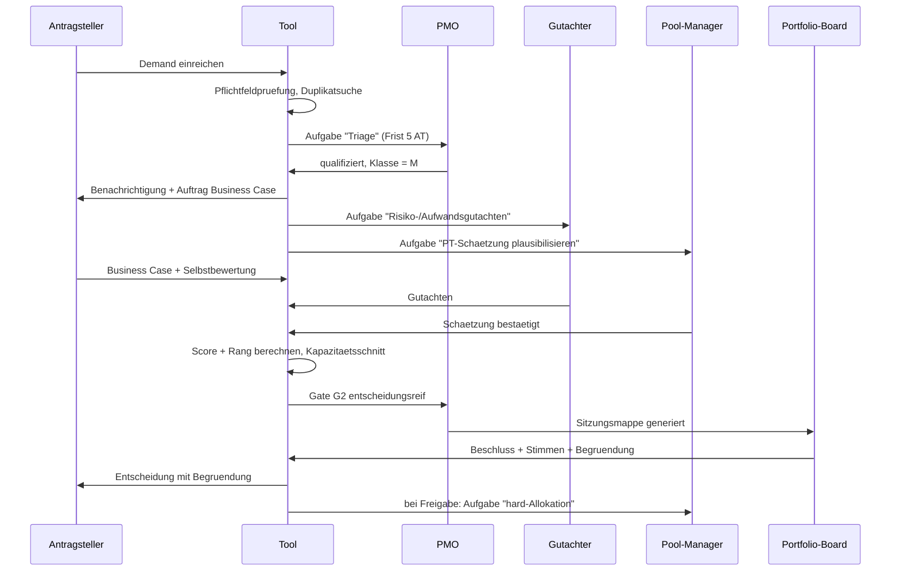

# 06 — Toolanforderungen

Ableitung aus den Kapiteln 01–05. Gegliedert nach Rollensichten, Berechtigungen, Workflows,
Schnittstellen und einem Umsetzungsschnitt.

## 1. Grundhaltung

Ein Governance-Tool scheitert fast immer aus demselben Grund: **Pflegeaufwand ohne
wahrnehmbaren Gegenwert für die Pflegenden.** Daraus folgen drei Entwurfsregeln:

| Regel | Konsequenz |
|---|---|
| **Jeder Beteiligte bekommt mehr zurück, als er einträgt** | Der Projektleiter, der Bedarf meldet, sieht sofort, ob er Kapazität bekommt. Der Antragsteller sieht, warum sein Demand wartet |
| **Einmal erfassen, überall verwenden** | Kein Feld wird an zwei Stellen gepflegt. Ressourcenbedarf kommt aus dem Projektplan, Ist-Kosten aus dem Controlling |
| **Das Tool erzeugt die Entscheidungsvorlage** | Wenn das PMO die Board-Unterlage weiterhin in PowerPoint baut, ist das Tool gescheitert |

## 2. Rollensichten

### 2.1 Antragsteller / Fachbereich
- Demand-Formular, kurz, mit Duplikatvorschlag beim Tippen
- **„Meine Anliegen"**: Status, aktuelle Stufe, nächster Entscheidungstermin, Entscheidung mit Begründung
- Transparenz über Wartegründe: *„wartet auf Kapazität Pool IT-Security, frühester Start Q3/2027"*
- Kein Zugriff auf fremde Business Cases oder Scores

### 2.2 Business Owner / Sponsor
- Portfolio des eigenen Bereichs mit Rängen und Status
- Business Case bearbeiten, Nutzenpositionen verantworten
- **Nutzennachweis-Aufgaben** (G6) mit Fristen
- Vergleichssicht: eigene Vorhaben gegen die Kapazitätslinie

### 2.3 Projektleiter
- Projekt-Cockpit: Status, Gates, offene Auflagen, Risiken, Change Requests
- Ressourcenbedarf melden und Zusagestand je Pool und Periode sehen (Ampel je Pool)
- Statusbericht erfassen — vorbefüllt aus Vorperiode, nur Deltas eingeben
- Gate-Einreichung mit **Vollständigkeitsanzeige** („4 von 7 Pflichtangaben erfüllt")

### 2.4 Ressourcenpool-Manager
- Poolprofil: Kapazität, Bedarf, soft/hard, Auslastung über 12–24 Monate
- Anfragenliste mit Portfolio-Rang der anfragenden Vorhaben — **die Rangspalte ist das
  entscheidende Element**, sie ersetzt die politische Diskussion durch eine Regel
- Zusagen erteilen, ablehnen, befristen
- Kapazitätsparameter pflegen (FTE, Quoten)
- Was-wäre-wenn: „was passiert, wenn ich Projekt X eine Periode später zusage?"

### 2.5 Board-Mitglied
- **Sitzungsmappe**: Tagesordnung, je Punkt eine Entscheidungsvorlage auf einer Bildschirmseite —
  Kurzbeschreibung, Nutzen, Kosten, Score, Rang, Ressourcenlage, Risiken, Empfehlung des PMO,
  Gutachten Architektur/Security
- Priorisierungssicht mit Kapazitätslinie und Drag-and-Drop-Umsortierung; das System zeigt
  **sofort die Folge** einer Verschiebung (welches Vorhaben rutscht unter die Linie)
- Abstimmung erfassen, Interessenkonflikt markieren
- Portfolio-Dashboard: Bucket-Balance, Engpassauslastung, Ampelverteilung, Nutzenbilanz

### 2.6 PMO / Portfolio-Manager
- Alles lesen, Verfahren steuern
- Triage-Arbeitsvorrat, Datenqualitäts-Cockpit (welche Pflichtfelder fehlen wo)
- Sitzungen anlegen, Tagesordnung aus entscheidungsreifen Gate-Instanzen generieren
- Protokoll und Beschlussnachverfolgung
- Konfiguration: Kriterienkatalog, Gewichte, Buckets, Schwellenwerte, Gate-Definitionen

### 2.7 Lenkungsausschuss
- Projekt-Cockpit des eigenen Vorhabens mit Status **und** Health-Indikator nebeneinander
- Change Requests innerhalb des Mandats entscheiden; das Tool zeigt, ob ein CR die Schwelle
  überschreitet und ans Portfolio-Board muss
- Budgettranchen innerhalb des Rahmens freigeben

### 2.8 Benefit Owner
- **„Meine Nutzenpositionen“**: Baseline, Zielwert, Prognose, nächster Messzeitpunkt
- Ist-Werte erfassen, auch Jahre nach Projektabschluss; Abweichungen begründen

### 2.9 Geschäftsführung / Management-Dashboard
- Ein Bildschirm, sechs Kacheln: Portfolio (aktiv/geplant/gestoppt, strategische Abdeckung) ·
  Finanzen (Budget, Ist, Forecast) · Kapazität (Engpässe, Auslastung) · Risiken (Top-Risiken,
  Eskalationen) · Entscheidungen (offene Beschlüsse, Entscheidungsalter) · Nutzen (geplant vs. realisiert)
- Drill-down von der Kachel auf das Portfolio, von dort auf das Projekt und per Link ins Planungstool
- Strategische Ziele und Bucket-Quoten pflegen bzw. freigeben

### 2.10 Revisor / Auditor
- Lesend: Entscheidungsregister, Audit-Log, Gate-Compliance, historische Ranglisten-Schnappschüsse,
  Versionen von Kriterienkatalog und Entscheidungsrechten
- Kein Zugriff auf laufende Arbeitsstände (Entwürfe), keine Schreibrechte

### 2.11 Beobachter / Betrieb / angrenzende Bereiche
- Read-only auf freigegebene Vorhaben, Termine, Meilensteine mit Betriebsbezug
- Keine Business Cases, keine Scores, keine Personendaten

## 3. Berechtigungsmatrix

L = lesen, S = schreiben, E = entscheiden, – = kein Zugriff, `eig.` = nur eigene Objekte

| Objekt | Antragst. | Sponsor | PL | Pool-Mgr | Board | PMO | Viewer |
|---|---|---|---|---|---|---|---|
| Demand (eigen) | S | S | L | L | L | S | – |
| Demand (fremd) | – | L eig. Bereich | L | L | L | S | – |
| Business Case | L eig. | **S** | S | L | L | L | – |
| Assessment / Scores | – | L eig. | L eig. | L | L | **S** | – |
| Kriterienkatalog | – | – | – | – | L | **S** | – |
| Projekt-Stammdaten | L eig. | S eig. | **S** eig. | L | L | S | L (freigeg.) |
| Statusbericht | – | L eig. | **S** eig. | L | L | L | – |
| Ressourcenbedarf | – | L eig. | **S** eig. | L | L | S | – |
| Allokation `soft`/`hard` | – | L eig. | L | **S/E** | L | L | – |
| Pool-Kapazität | – | – | L | **S** eig. Pool | L | S | – |
| Gate-Einreichung | – | S eig. | **S** eig. | – | L | S | – |
| Decision / Vote | – | L eig. | L eig. | L | **E** | S (protokoll.) | – |
| Auflagen (Conditions) | – | S eig. | S eig. | L | E | S | – |
| Change Request | – | L eig. | **S** eig. | L | E (> Schwelle) | S | – |
| Konflikte | – | L eig. | L eig. | S eig. Pool | E | S | – |
| Nutzenreview | – | **S** eig. | L | – | E | S | – |
| Portfolio-Dashboard | – | L eig. Bereich | L | L | **L** | L | eingeschränkt |
| Audit-Log | – | – | – | – | L | L | – |
| Strategische Ziele | – | L | L | L | L | S | L |
| Entscheidungsrechte, Gate-Sets, KPI-Definitionen | – | – | – | – | L | **S** | – |
| Risiken / Issues | – | L eig. | **S** eig. | L | L | S | – |
| Baseline | – | L eig. | L eig. | L | L | L | – |
| Budgettranche | – | L eig. | L eig. | – | E | L | – |
| Szenario | – | – | – | S | S | **S** | – |
| Nutzenposition (Ist-Werte) | – | S eig. | L | – | L | L | – |

Ergänzende Rollen: **Lenkungsausschuss** wie Board, aber nur für das eigene Projekt und nur innerhalb
seines Mandats (E bei Change Requests unter Schwelle und Budgettranchen). **Benefit Owner** schreibt
Ist-Werte und Prognose seiner Nutzenpositionen. **Revisor** liest Decisions, Votes, Audit-Log,
Konfigurationsversionen; sonst nichts.

**Regeln, die im Code hart verankert gehören:**
1. Das PMO kann alles schreiben, **außer** Decisions und Votes — es protokolliert sie nur.
   Sonst verliert die Entscheidungshistorie ihre Beweiskraft.
2. Ein Board-Mitglied kann seine eigene Stimme nach Sitzungsabschluss nicht mehr ändern.
3. **Funktionstrennung:** Wer Antragsteller oder Sponsor eines Vorhabens ist, kann es weder als
   Prüfer bewerten noch darüber abstimmen (Kapitel 01, 8).
4. Eine Entscheidung kann nur von der Instanz erfasst werden, die laut Entscheidungsrechte-Matrix
   zuständig ist; abweichende Zuständigkeit nur mit protokollierter Ausnahme durch das nächsthöhere Gremium.

## 4. Kernworkflows

### 4.1 Demand → Entscheidung

### 4.2 Konfliktauflösung

1. System erkennt Konflikt (Regeln Kapitel 04, 4) → `CONFLICT` mit `escalation_level = 1`
2. Aufgabe an PL und Pool-Manager, Frist 5 Arbeitstage
3. Bei Lösung: Allokation angepasst, `resolution_option` + `rejected_options` erfasst
4. Ohne Lösung nach Frist: automatische Hochstufung auf Level 2, Aufnahme in die Tagesordnung
   des nächsten Ressourcen-Boards
5. Analog Level 3 → Portfolio-Board
6. Jeder Übergang erzeugt Benachrichtigung und Audit-Eintrag

Die **automatische Fristeskalation** ist die wichtigste Funktion des ganzen Workflows: sie sorgt
dafür, dass ein Konflikt nicht durch Aussitzen gewonnen werden kann.

### 4.3 Sitzungszyklus

Vorbereitung (T-10 Tage: entscheidungsreife Gates einsammeln, Vollständigkeit prüfen) →
Tagesordnung (T-7: PMO priorisiert, Mappe wird versendet/freigeschaltet) →
Sitzung (Vorlagen im Tool, Abstimmung digital erfasst) →
Nachbereitung (Beschlüsse werden **Objekte**: Auflagen mit Verantwortlichen und Fristen,
Allokationsaufträge, Statusänderungen — automatisch generiert, nicht abgetippt) →
Nachverfolgung (offene Auflagen erscheinen automatisch auf der nächsten Tagesordnung)

### 4.4 Benachrichtigungen

| Ereignis | Empfänger |
|---|---|
| Demand eingereicht | PMO |
| Rückfrage / Statuswechsel eines Demands | Antragsteller, Sponsor |
| Gutachtenauftrag | Gutachter (mit Frist) |
| Gate entscheidungsreif | PMO, Board |
| Beschluss gefasst | Antragsteller, Sponsor, PL, betroffene Pool-Manager |
| Auflage fällig in 7 Tagen / überfällig | Verantwortlicher, PMO |
| Konflikt erkannt / eskaliert | PL, Pool-Manager, ab Level 2 Board |
| Statusbericht überfällig | PL, danach PMO |
| Nutzenreview fällig | Sponsor, PMO |
| `soft`-Allokation verfällt in 30 Tagen | PL, Pool-Manager |

Digest-Prinzip: eine gebündelte Tagesmail statt Einzelmeldungen; nur Eskalationen sofort.

## 5. Berichte

| Bericht | Empfänger | Takt |
|---|---|---|
| Portfolio-Einseiter (Ampeln, Bucket-Balance, Top-Risiken, Engpässe) | Geschäftsleitung | monatlich |
| Priorisierungsliste mit Kapazitätslinie | Board | quartalsweise |
| Kapazitäts-Heatmap je Pool | Ressourcen-Board | monatlich |
| Entscheidungslog | Revision, Board | auf Abruf |
| Nutzenbilanz (zugesagt vs. realisiert) | Board, Controlling | halbjährlich |
| Ungedeckter Bedarf | Board, Personalplanung | jährlich zur Budgetierung |
| Datenqualitätsbericht | PMO | wöchentlich |
| Portfolio-Risikobericht (eskalierte und projektübergreifende Risiken) | Board | monatlich |
| Finanzbericht (Rahmen, Ist, Forecast, Abweichung je Bucket) | Board, Controlling | monatlich |
| Beschluss- und Maßnahmenverfolgung (offene/überfällige Auflagen und Actions) | Board, PMO | je Sitzung |
| Strategische Abdeckung (Ziele × Vorhaben × Kapazität) | Geschäftsführung | quartalsweise |

Alle Berichte als Bildschirmsicht **und** als PDF/Export — Board-Sitzungen laufen erfahrungsgemäß
nicht papierlos.

## 6. Schnittstellen

Fachliche Sicht; die technische Umsetzung unter Nextcloud steht in Kapitel 07.

| System | Richtung | Inhalt |
|---|---|---|
| **Projektplanung** (Gantt, OpenProject, Deck, MS Project …) | bidirektional | *hin*: freigegebene Projekte, Rahmentermine, zugesagte Kapazität je Pool · *zurück*: Termine, Meilensteine, Fortschritt, zeitlich verteilter Restbedarf je Rolle/Pool |
| Verzeichnisdienst (LDAP/OIDC, über Nextcloud) | ein | Personen, Gruppen, Org-Einheiten, Single Sign-on |
| HR / Ressourcenplanung | ein | FTE je Pool, Org-Struktur |
| Zeiterfassung | ein | Ist-Aufwand je Projekt und Pool → `ALLOCATION.actual` |
| Finanzsystem / ERP | ein | Ist-Kosten, gebundene Mittel, Budgetstände |
| Ticketsystem / Service Management | ein | Kleinanforderungen als Demand-Quelle, Betriebsaufwand für die Linienquote |
| Enterprise Architecture / ISMS | ein | betroffene Systeme, Architekturstandards, Abhängigkeiten, Sicherheitsbewertungen |
| Dokumentenablage (Nextcloud Files) | bidirektional | Business Cases, Protokolle, Nachweise |
| Kalender (CalDAV) | aus | Sitzungstermine, Gate-Fristen |
| BI / Data Platform | aus | Export der Sichten aus Kapitel 05, 12 (CSV/OData/REST) |

**Integrationsregel:** Für jedes Feld, das ein Umsystem liefert, wird festgelegt, welches System
führend ist (Kapitel 07, 3). Die Governance-App spiegelt fremde Daten nur lesend und zeigt ihre Herkunft.

**Zur Gantt-Kopplung:** Die Governance-Ebene führt Ränge, Freigaben und Kapazitätszusagen; die
Planungsebene führt Termine und Fortschritt. Doppelte Datenhoheit ist zu vermeiden — je Feld ist
ein System führend, das andere spiegelt. Sinnvoller Schnitt: alles vor G3 gehört der Governance,
alles nach G3 auf Terminebene gehört der Planung.

## 7. Nichtfunktionale Anforderungen

- **Nachvollziehbarkeit:** lückenloses Audit-Log, unveränderliche Entscheidungen, Wiederherstellung
  jedes historischen Portfolio-Stands („wie sah die Rangliste am Tag der Entscheidung aus?")
- **Konfigurierbarkeit ohne Deployment:** Kriterien, Gewichte, Quoten, Schwellen, Gate-Sets,
  Fristen sind Daten
- **Datenschutz:** Portfolio-Ebene arbeitet auf Pools, nicht auf Personen. Personenscharfe
  Auslastung ist bewusst **nicht** vorgesehen — sie ist mitbestimmungspflichtig und für die
  Portfolio-Steuerung nicht erforderlich. Frühzeitige Einbindung des Betriebsrats einplanen
- **Vertraulichkeit:** Business Cases enthalten oft sensible Zahlen; feingranulare
  Sichtbarkeitssteuerung auf Feldebene für `confidential`-Anhänge und Kommentare
- **Performance:** Kapazitätsschnitt über ~300 Vorhaben × 20 Pools × 24 Perioden muss interaktiv
  laufen (< 2 s) — vorberechnete Sichten einplanen
- **Bedienbarkeit:** Demand-Erfassung in unter 5 Minuten. Jede zusätzliche Pflichtfrage am Eingang
  kostet Vollständigkeit an anderer Stelle
- **Barrierefreiheit und Mehrsprachigkeit** je nach Unternehmenskontext
- **Mandantenfähigkeit:** Mehrere Portfolios (z. B. je Geschäftsbereich) mit eigenem Kriterienkatalog,
  eigenen Entscheidungsrechten und Gate-Sets; Sichtbarkeit standardmäßig auf das Portfolio begrenzt
- **Identität:** Single Sign-on und Benutzerverwaltung ausschließlich über Nextcloud (LDAP/OIDC dort
  angebunden); keine eigene Passwortverwaltung
- **Sicherheitsprotokoll:** Rechteänderungen, Konfigurationsänderungen und Exporte werden protokolliert
- **Aufbewahrung und Löschung:** Decisions und Audit-Log unterliegen einer konfigurierbaren
  Aufbewahrungsfrist (z. B. 10 Jahre); abgelehnte Demands werden nach Frist anonymisiert; beim Löschen
  eines Nextcloud-Kontos bleiben Entscheidungen erhalten, die Person wird pseudonymisiert
  (Anzeigename eingefroren)
- **Datenherkunft:** jede Kennzahl ist bis zu ihren Quelldaten nachvollziehbar (Drill-down, Herkunft je Feld)

### 7.1 Automatisierung und KI (Ausbaustufe)

Mögliche Einsatzfelder, umgesetzt über die Nextcloud-Assistant-/TaskProcessing-Schnittstelle (also
mit dem vom Betreiber gewählten, ggf. lokalen Modell):

- Widersprüche zwischen Status, Risiken, Kosten und Terminen erkennen (ergänzt den regelbasierten
  Health-Indikator)
- Zusammenfassungen von Projekt- und Portfoliostand, Entwurf von Entscheidungsvorlagen
- Dublettenerkennung beim Demand-Eingang über semantische Ähnlichkeit
- Muster bei Verzögerungen und Budgetüberschreitungen

Leitplanken: KI-Ergebnisse sind sichtbar als Vorschlag gekennzeichnet · Datenbasis und Unsicherheit
werden angezeigt · Entscheidungen mit Governance-Wirkung bleiben bei legitimierten Personen · KI sieht
nur, was der auslösende Benutzer sehen darf · Aufrufe werden protokolliert · ohne konfigurierten
KI-Anbieter funktioniert die App vollständig.

## 8. Capability-Katalog und MVP-Schnitt

### 8.1 Produktvision und MVP-Prinzip

Die Produktvision ist **End-to-End-Projekt-Governance** (vom Demand bis zum Nutzenreview). Der MVP
muss aber bereits einen **geschlossenen Steuerungskreislauf** liefern: Ein Antrag kann von der
Einreichung über Bewertung und Entscheidung bis zur Aufnahme ins Portfolio und zur ersten
Projektfreigabe nachvollziehbar gesteuert werden — und zwar **gegen die verfügbare Kapazität**, denn
das ist die Kernannahme dieses Konzepts.

### 8.2 Capability-Katalog

Die IDs dienen als Epics im Backlog der App. Spalte *Stufe* verweist auf 8.3.

| ID | Capability | Erwartetes Verhalten | Kapitel | Stufe |
|---|---|---|---|---|
| GOV-001 | Organisationsmodell | Org-Einheiten, Portfolios, Gremien verwalten | 01, 05 | 1 |
| GOV-002 | Rollen und Rechte | kontextgebundene Rollen, Stellvertretung, Berechtigungsmatrix | 01, 06 | 1 |
| GOV-003 | Governance-Konfiguration | Kriterien, Gate-Sets, Schwellen, Entscheidungsrechte als versionierte Daten | 02, 03, 05 | 2–3 |
| STR-001 | Strategische Ziele | Zielhierarchie, Versionen, Zuordnung zu Vorhaben, Abdeckung | 02, 05 | 2 |
| DEM-001 | Intake | ein Eingang, Antragstypen, Dublettenvorschlag | 02 | 1 |
| DEM-002 | Triage | Vollständigkeit, Klasse, Entscheidungscodes, Wiedervorlage | 02 | 1 |
| DEM-003 | Antragshistorie | Rückfragen, Änderungen, Entscheidungen nachvollziehen | 02, 05 | 1 |
| POR-001 | Portfolioübersicht | Vorhaben über Org und Zeit aggregieren, Portfoliophasen | 02 | 1 |
| POR-002 | Scoring | versionierte Kriterien, Mehrfachbewertung, Wertdichte | 03 | 2 |
| POR-003 | Szenarioanalyse | Was-wäre-wenn auf Kopien, Vergleich mit Ist | 04 | 5 |
| POR-004 | Kapazitätsabgleich | Pools, Kapazitätsrechnung, Heatmap, Kapazitätsschnitt | 04 | 1–2 |
| DEC-001 | Entscheidungsregister | Decisions mit Mandat, Begründung, Optionen, unveränderlich | 01, 05 | 1 |
| DEC-002 | Gremienworkflow | Sitzungen, Tagesordnung, Vorlagen, Abstimmung, Quorum | 06 | 3 |
| DEC-003 | Beschluss- und Maßnahmenverfolgung | Auflagen und Actions mit Fristen und Eskalation | 02, 05 | 3 |
| LIF-001 | Phasenmodell | konfigurierbare Gate-Sets je Klasse/Typ | 02 | 3 |
| LIF-002 | Stage Gates | Vollständigkeitsprüfung, Beschlussarten, Budgettranchen | 02 | 3 |
| PRJ-001 | Projektstatus | Statusbericht, Ampel, berechneter Health-Indikator | 02 | 4 |
| PRJ-002 | Meilensteine und Baselines | governance-relevante Meilensteine, Baseline-Versionen, Forecast | 02, 05 | 4 |
| PRJ-003 | Maßnahmen | Actions aus Risiken, Issues, Berichten | 02 | 4 |
| RES-001 | Ressourcen | Allokationsstufen, WIP, Konflikterkennung, Eskalation | 04 | 1–4 |
| FIN-001 | Business Case | strukturiert, versioniert, Annahmen | 03 | 2 |
| FIN-002 | Budgetsteuerung | Rahmen, Tranchen, Ist, FAC, Abweichung, Bucket-Budget | 03 | 4 |
| RSK-001 | Risiken und Issues | Methodik, Restrisiko, projektübergreifende Risiken, Portfolio-Risikosicht | 02 | 4 |
| CHG-001 | Change Requests | Auswirkungsanalyse, Schwellenlogik, Re-Baselining | 02 | 4 |
| BEN-001 | Nutzenregister | Positionen mit Baseline, Ziel, Prognose, Owner | 03 | 2 (Erfassung), 5 (Steuerung) |
| BEN-002 | Nutzenreviews | mehrere Messzeitpunkte, Abweichungsanalyse, Rückkopplung | 03 | 5 |
| REP-001 | Dashboards und Berichte | rollenbezogene Sichten, Management-Dashboard, PDF-Export | 06 | 1–5 |
| REP-002 | KPI-Definitionen | Kennzahlen als konfigurierte Objekte mit Quelle und Schwellen | 01, 05 | 4 |
| AUD-001 | Audit Trail | lückenlos, manipulationsnachvollziehbar, Ranglisten-Schnappschüsse | 05 | 1 |
| INT-001 | Planungs-Integration | Gantt-Adapter, weitere Provider | 07 | 2 (Gantt), 4+ (weitere) |
| INT-002 | Umsysteme | Zeiterfassung, Finanzen, Ticketsystem, BI-Export | 06, 07 | 4–5 |
| DAT-001 | Datenqualität | Pflichtfelder, Plausibilität, Daten-Owner, Cockpit | 05, 06 | 1 (Pflichtfelder), 3 (Cockpit) |
| AI-001 | KI-Assistenz | Zusammenfassungen, Widersprüche, Vorlagen-Entwürfe | 06, 7.1 | 5 |

### 8.3 Stufenplan

Der häufigste Fehler ist der Versuch, alles auf einmal einzuführen. Empfohlene Reihenfolge —
jede Stufe ist für sich nutzbar. Stufe 1 und 2 zusammen bilden den **MVP** im Sinne von 8.1.

### Stufe 1 — Fundament und Transparenz (ca. 2–3 Monate)
Org-Einheiten, Portfolios, Gremien, kontextgebundene Rollen (GOV-001/002) · Demand-Eingang mit
Antragstypen und Dublettenvorschlag, Triage mit verbindlichen Entscheidungscodes und Wiedervorlage
(DEM-001–003) · Portfolioübersicht mit Portfoliophasen (POR-001) · Ressourcenpools,
Kapazitätsrechnung, manuelle Bedarfserfassung je Pool und Periode, Auslastungs-Heatmap (POR-004,
RES-001) · **einfaches Entscheidungsregister** — Beschlüsse mit Begründung und Mandat, noch ohne
Sitzungsworkflow (DEC-001) · Audit-Log (AUD-001) · rollenbasierte Sichten

*Nutzen ohne jede Governance-Regel:* Zum ersten Mal sieht das Unternehmen, wie viel es sich
vorgenommen hat und wie viel es kann, und jede Annahme, Ablehnung oder Zurückstellung ist
dokumentiert. Diese Stufe allein löst bereits Diskussionen aus und rechtfertigt das Projekt.

### Stufe 2 — Bewertung, Priorisierung, erste Freigabe (ca. 2–3 Monate) — **MVP komplett**
Strategische Ziele und Zuordnung (STR-001) · Kriterienkatalog versioniert, Assessment mit Scoring
(POR-002, GOV-003) · Business Case strukturiert, Nutzenpositionen mit Baseline (FIN-001, BEN-001) ·
Buckets, Rangliste, Kapazitätsschnitt mit Startplan · vereinfachtes G3 (Freigabe mit
Pflichtfeldprüfung und harter Allokation) · **Gantt-Adapter v1**: freigegebenes Projekt in Gantt
anlegen und verknüpfen, Meilensteine und Fortschritt lesen (INT-001)

*Ergebnis:* geschlossener Kreislauf Demand → Bewertung → Entscheidung → Portfolio → Freigabe →
Projekt im Planungstool.

### Stufe 3 — Entscheidungsprozess (ca. 2–3 Monate)
Konfigurierbare Gate-Sets und Gate-Instanzen mit Vollständigkeitsprüfung, alle Beschlussarten,
Budgettranchen (LIF-001/002) · Entscheidungsrechte-Matrix (GOV-003) · Sitzungen, Tagesordnung,
Entscheidungsvorlagen mit Optionen und Empfehlung, Abstimmung mit Quorum und Stellvertretung,
Kalender- und Talk-Anbindung (DEC-002) · Auflagen und Actions mit Nachverfolgung (DEC-003) ·
Datenqualitäts-Cockpit (DAT-001)

### Stufe 4 — Steuerung im Betrieb (ca. 2–3 Monate)
Statusberichte mit Ampel und berechnetem Health-Indikator (PRJ-001) · Baselines und Forecast
(PRJ-002) · Risiken, Issues, Maßnahmen, Portfolio-Risikosicht (RSK-001, PRJ-003) · Change Requests
mit Auswirkungsanalyse und Schwellenlogik (CHG-001) · Budgetsteuerung mit FAC (FIN-002) ·
automatische Konflikterkennung und Fristeskalation (RES-001) · Benachrichtigungen und Tages-Digest ·
KPI-Definitionen (REP-002) · **Gantt-API v2**: Ressourcenbedarf je Rolle/Periode, Projekt-Events
(Kapitel 07, 5) · Zeiterfassung und Finanzen (INT-002)

### Stufe 5 — Lernschleife und Optimierung (ca. 2 Monate)
Nutzenreviews mit mehreren Messzeitpunkten, Soll/Ist-Nutzenbilanz (BEN-002) · Nachkalkulation und
Schätzkorrekturfaktoren · Szenarioanalyse (POR-003) · Management-Dashboard vollständig (REP-001) ·
weitere Planungs-Provider (OpenProject, MSPDI) · KI-Assistenz (AI-001)

**Integrationen** laufen quer und werden dort angedockt, wo die jeweilige Stufe sie zuerst braucht.
Jede Stufe endet mit einem Release im Nextcloud-App-Store.

## 9. Einführungsrisiken

| Risiko | Gegenmaßnahme |
|---|---|
| Bewertungsinflation — alles bekommt Höchstwerte | Ankertexte, Pflicht-Begründung bei Werten 5 und 8, Kalibrierungsrunden, Vier-Augen-Bewertung |
| Schattenprojekte am Verfahren vorbei | Zeiterfassung gegen Portfolio abgleichen; Aufwand ohne Projektbezug sichtbar machen |
| Datenpflege verfällt | Datenqualitäts-Cockpit, „keine Entscheidung ohne Daten" konsequent durchhalten, Vorbefüllung |
| Board entscheidet doch nach Zuruf | Board-Korrekturen als Delta ausweisen und in der Kennzahl führen — sichtbarer Widerspruch korrigiert sich meist selbst |
| Tool wird als Kontrollinstrument empfunden | Poolebene statt Personenebene, Betriebsrat früh einbinden, Nutzen für Erfassende sichtbar machen |
| Überkomplexität | Vorhabensklassen (XS/S) mit verkürztem Pfad ernst nehmen — sonst erstickt das Verfahren am Kleinkram |
| Tool wird eingeführt, Mandate bleiben unklar | Entscheidungsrechte-Matrix und Gremien **vor** oder parallel zur Konfiguration verabschieden; ohne Mandat kein Go-Live von Stufe 3 |
| Scoring wird als automatische Wahrheit verstanden | Begründungspflicht für jede Decision, sieben Leitfragen in der Vorlage (Kapitel 03), Score nur als ein Element der Vorlage |
| Doppelpflege mit bestehenden Tools | führende Systeme je Feld festlegen (Kapitel 07, 3), Vorbefüllung aus dem Planungstool |
| Reporting wird geschönt | berechneter Health-Indikator neben der Meldung, Widersprüche begründungspflichtig, Datenherkunft sichtbar |

## 10. Offene Konzeptentscheidungen

Vor der Detailplanung zu klären. Wo das Konzept einen Standard vorschlägt, ist er angegeben; die
App sollte so gebaut werden, dass die Antwort Konfiguration ist und kein Umbau.

| # | Frage | Vorschlag / Standard im Konzept |
|---|---|---|
| 1 | Welche Org-Einheiten und Vorhabenarten umfasst die Lösung? | zunächst IT-nahe Vorhaben einer Organisation; Mandantenfähigkeit über Portfolios |
| 2 | Nur Projekte oder auch Programme, Produkte, Initiativen? | Projekte und Programme; Produkte/Linie nur als Kapazitätsabzug |
| 3 | Welche Governance-Ebenen sind verbindlich im Scope? | Portfolio- und Projekt-Governance voll, Strategie schlank, operatives PM über Integration (Kapitel 01, 1.1) |
| 4 | Welche Gremien gibt es, mit welchem Mandat? | Gremien als Konfiguration; Standard-Set aus Kapitel 01, 3 |
| 5 | Welche Schwellen gelten für Budget, Risiko, strategische Bedeutung? | Beispielwerte in Kapitel 01, 6.1 und 02, 4.4 |
| 6 | Welche Vorhaben brauchen einen Sonderpfad? | Bucket A (Pflicht), Fast-Track, Klasse XS/S |
| 7 | Ressourcenplanung auf Rollen-, Skill- oder Personenebene? | **Pool-/Rollenebene**, keine Personenplanung (Kapitel 04, 1) |
| 8 | Welche Systeme sind führend für Kosten, Personal, Termine, Dokumente? | Finanzsystem, HR, Planungstool, Nextcloud Files (Kapitel 07, 3) |
| 9 | Anforderungen an Datenschutz, Informationssicherheit, Audit, Aufbewahrung? | Abschnitt 7; Betriebsrat früh einbinden |
| 10 | Welche Kennzahlen braucht welches Gremium? | KPI-Set aus Kapitel 01, 10 als Startkonfiguration |
| 11 | Was muss ohne Entwicklung konfigurierbar sein? | Kriterien, Gewichte, Quoten, Gate-Sets, Entscheidungsrechte, Schwellen, Formulare, KPI-Definitionen |
| 12 | Was ist für den MVP unverzichtbar? | Stufe 1 + 2 (Abschnitt 8.3) |
| 13 | Rechtsform der Abstimmung: reichen digitale Stimmen im Tool als Beschlussnachweis? | mit Satzung/Geschäftsordnung klären; sonst Protokoll-PDF als Anhang der Decision |
