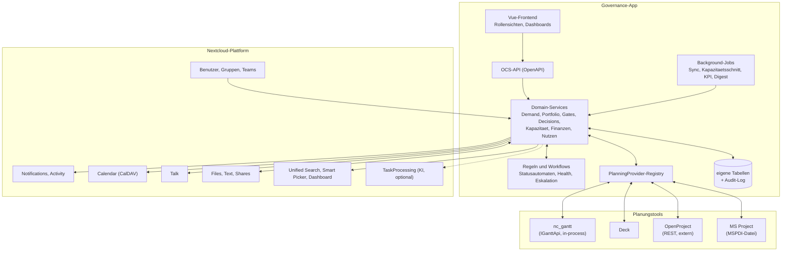

# 07 — Architektur unter Nextcloud und Integration der Planungstools

Technische Umsetzung des Konzepts als Nextcloud-App. Grundlage sind die Community-Standards des
Nextcloud Developer Manuals (OCP-Schnittstellen, OCS-API, Vue-Frontend mit `@nextcloud/vue`).

## 1. Grundsatzentscheidung: eigene App statt Gantt-Modul

Die Governance wird als **eigenständige Nextcloud-App** gebaut. nc_gantt ist das erste, aber nicht
das einzige angebundene Planungstool.

| Kriterium | Modul in Gantt | Eigene App (gewählt) |
|---|---|---|
| **Zielgruppe** | Gantt nutzen kleine Teams und Projektleiter | PMO, Board, Pool-Manager, Antragsteller — die meisten öffnen nie ein Gantt-Diagramm; eigene Navigation und Rollensichten |
| **Rechtemodell** | Gantt-Rollen gelten pro Projekt | Governance braucht projektübergreifende, bereichsbezogene Rechte, Vertraulichkeit auf Feldebene und unveränderliche Entscheidungen (Kapitel 06, 3) |
| **Werkzeugneutralität** | nur Gantt | Gantt, Deck, OpenProject, MS-Project-Import sind gleichwertige Quellen |
| **Datenhoheit** | Grenze verschwimmt in einer gemeinsamen Datenbank | die API erzwingt „je Feld ein führendes System“ (P12) |
| **Releases und Gewicht** | Gantt wird schwerer, auch für alle ohne Governance-Bedarf | getrennte Versionen, eigener App-Store-Eintrag |
| **Aufwand** | kurzfristig geringer | Schnittstelle nötig — in Gantt mit `IGanttApi` bereits zum Teil vorhanden |

Gantt bleibt **optionale** Abhängigkeit: Die Governance-App funktioniert ohne Planungstool (Termine
und Bedarf dann manuell gepflegt) und erkennt installierte Provider zur Laufzeit.

## 2. Architekturüberblick



## 3. Datenhoheit je Feld

Leitlinie: **Alles vor G3 gehört der Governance, alles nach G3 auf Terminebene gehört der Planung.**
Je Feld genau ein führendes System; das andere spiegelt lesend und zeigt die Herkunft.

| Datum | führend | Richtung | Bemerkung |
|---|---|---|---|
| Projekt anlegen, Titel, Beschreibung | Governance | → Planung | bei G3; Planungstool darf Titel nicht abweichend führen (Warnung bei Abweichung) |
| Rahmentermine (Start, Ende laut Baseline) | Governance | → Planung | als Rahmen angezeigt, nicht als Vorgabe für einzelne Vorgänge |
| Gate-Termine, Meilensteine mit externer Zusage | Governance | → Planung | als Meilensteine angelegt, Rückverknüpfung über `source_ref` |
| Detailtermine, Vorgänge, Abhängigkeiten | Planung | – | bleiben im Planungstool |
| Forecast-Termine der Governance-Meilensteine | Planung | → Governance | Basis für Health-Indikator |
| Fortschritt | Planung | → Governance | Vorbefüllung des Statusberichts |
| Ressourcenbedarf je Rolle und Periode | Planung (ab G3) | → Governance | über Rolle → Pool in `RESOURCE_DEMAND` (`source = planning_link`) |
| Kapazitätszusage je Pool | Governance | → Planung (lesend) | Planungstool kann Überplanung gegen die Zusage anzeigen |
| Ist-Aufwand | Zeiterfassung | → Governance | falls vorhanden; sonst aus Planung |
| Ist-Kosten | Finanzsystem | → Governance | Gantt-`actual_cost` nur, wenn kein Finanzsystem angebunden |
| Status, Ampel, Risiken (Governance-Sicht) | Governance | – | Gantt-`risk_level` je Vorgang bleibt Detailinformation |

Die Feldhoheit ist pro `PLANNING_LINK` als `field_ownership` gespeichert, damit ein Kunde
einzelne Zeilen anders schneiden kann.

## 4. Planungs-Provider-Schnittstelle

### 4.1 Registry

Die Governance-App definiert ein Interface und ein Registrierungs-Event — dasselbe Muster, das
nc_gantt mit `RegisterTaskSourceProvidersEvent` bereits nutzt:

```php
namespace OCA\Governance\Planning;

interface IPlanningProvider {
    public function getId(): string;                 // 'gantt', 'openproject', ...
    public function getName(): string;
    public function getCapabilities(): array;        // ['create_project','milestones','progress','resource_demand','events']

    public function createProject(string $userId, ProjectSeed $seed): ExternalRef;
    public function linkProject(string $userId, string $externalId): ExternalRef;
    public function getProjectSummary(string $userId, ExternalRef $ref): ProjectSummary;   // Termine, Fortschritt, Ampel
    public function getMilestones(string $userId, ExternalRef $ref): array;
    public function upsertMilestone(string $userId, ExternalRef $ref, MilestoneSeed $m): string;
    public function getResourceDemand(string $userId, ExternalRef $ref, Period $from, Period $to): array; // [roleRef, period, personDays]
    public function listRoles(string $userId): array;                                     // für ROLE_POOL_MAPPING
}

final class RegisterPlanningProvidersEvent extends \OCP\EventDispatcher\Event {
    public function register(IPlanningProvider $provider): void { ... }
}
```

Nicht jeder Provider kann alles; die Oberfläche richtet sich nach `getCapabilities()`.

### 4.2 Synchronisation

- **In-process-Provider** (Gantt, Deck): Änderungen kommen über Events sofort; zusätzlich ein
  nächtlicher Abgleich als Sicherheitsnetz
- **Externe Provider** (OpenProject REST API v3, Jira): periodischer Abgleich per Background-Job,
  Webhooks wo verfügbar; Zugangsdaten im Nextcloud-Credential-Store, nicht in App-Tabellen
- **Dateibasiert** (MSPDI): Import eines Projektplans als Schnappschuss, Herkunft „Datei vom …“
- Abgleichsfehler setzen `PLANNING_LINK.sync_status` und erscheinen im Datenqualitäts-Cockpit;
  sie blockieren nie die Governance-Funktionen
- Der **Kapazitätsschnitt** arbeitet nur auf den gespiegelten Daten in der Governance-Datenbank,
  nie live gegen Provider (Anforderung < 2 s, Kapitel 06, 7)

### 4.3 Rolle → Pool

Planungstools planen Personen oder Rollen, die Governance plant Pools. `ROLE_POOL_MAPPING`
(Kapitel 05, 8) übersetzt; gepflegt vom PMO bzw. Pool-Manager, je Provider. Nicht zugeordnete
Rollen erscheinen als „unzugeordneter Bedarf“. Personenbezogene Daten aus dem Planungstool werden
**vor** dem Speichern auf Pool-Ebene aggregiert (Datenschutz, Kapitel 06, 7).

## 5. Anbindung nc_gantt

### 5.1 Vorhanden (IGanttApi v1, nc_gantt ≥ 2.4)

| Baustein | Nutzung durch die Governance |
|---|---|
| `IGanttApi::listProjects`, `createProject`, `getUrl` | Projekt bei G3 anlegen bzw. bestehendes verknüpfen, Rücklink |
| `getTasks`, `getTask`, `createTask`, `updateTask` | Governance-Meilensteine als Aufgaben/Meilensteine anlegen; Fortschritt und Termine lesen |
| `forApp('nc_governance')`, `source_ref`, `source_url`, `findTasksBySource` | von der Governance angelegte Objekte markieren und wiederfinden |
| `TaskCreatedEvent`, `TaskUpdatedEvent`, `TaskDeletedEvent` | Änderungen ohne Polling übernehmen |
| `RegisterTaskSourceProvidersEvent`, `ITaskSourceProvider` | Governance registriert sich als Quelle → Gantt zeigt an verknüpften Aufgaben Label, Icon und Rücklink |

Damit ist **Stufe 2** (Gantt-Adapter v1) ohne Änderung an Gantt umsetzbar, mit einer Einschränkung:
Fortschritt und Termine auf Projektebene müssen aus den Aufgaben aggregiert werden.

### 5.2 Benötigt für Stufe 4 (IGanttApi v2, eigenes Issue in nc_gantt)

1. **Projekt-Events** — `ProjectCreated/Updated/Deleted/ArchivedEvent`; bisher gibt es nur Task-Events
2. **`getProjectSummary()`** — Start, Ende, Fortschritt gesamt, Anzahl überfälliger Aufgaben,
   kritischer Pfad betroffen ja/nein
3. **Meilensteine** über die API lesen und anlegen (Gantt hat eine eigene Meilenstein-Tabelle, die
   v1 nicht freigibt)
4. **`getResourceDemand(projectId, from, to, granularity)`** — Personentage je **Rollen-Ressource**
   und Periode, berechnet aus `TaskResource.work` über die Laufzeit der Aufgaben; Personen-Ressourcen
   werden über die Rollenzuordnung (`ResourceRole`) auf Rollen verdichtet
5. **`listRoleResources()`** — für das Mapping Rolle → Pool
6. **Baselines lesen** (optional) — Gantt kennt Baselines bereits; nützlich für Termintreue-KPIs
7. **Erweiterungspunkt für einen Read-only-Reiter** in der Gantt-Seitenleiste (Event, über das eine
   App einen Reiter registriert): zeigt Gate-Status, zugesagte Kapazität und offene Auflagen im
   Projekt, ohne dass Gantt Governance-Logik enthält

Alle Punkte sind abwärtskompatibel umsetzbar (neue Methoden/Capabilities) und fallen unter die
Versionsregel von `IGanttApi`.

## 6. Nextcloud-Bausteine und Abbildung des Datenmodells

| Konzept | Nextcloud-Baustein |
|---|---|
| PERSON | Nextcloud-Benutzer (`uid`); Anzeigename über `IUserManager`. Keine eigene Personentabelle — nur ein Pseudonymisierungs-Schnappschuss für gelöschte Konten |
| ORG_UNIT | eigene Tabelle; optional initial aus Gruppen oder LDAP-Attributen befüllt |
| Gremien-Mitgliedschaft | `ROLE_ASSIGNMENT`; optional an ein Nextcloud-Team (Circles) gekoppelt, damit Dateien und Talk-Raum automatisch passen |
| Benachrichtigungen, Digest | `OCP\Notification` (sofort, Eskalationen) + Activity-Provider + täglicher Background-Job für den Digest |
| Sitzungstermine, Gate-Fristen | Kalender über die OCP-Calendar-API (`ICreateFromString`), Einladung an die Gremienmitglieder |
| Board-Sitzung | Talk-Raum je Gremium, Link in der Sitzungsmappe |
| Business Case als Dokument, Protokolle, Nachweise | Files, Text; Anhänge mit automatischer Freigabe an berechtigte Rollen (Muster aus dem Gantt-Anhänge-Reiter) |
| Demands, Projekte, Beschlüsse finden und verlinken | Unified-Search-Provider, Reference-Provider (Smart Picker), Dashboard-Widgets („Meine Anliegen“, „Meine Entscheidungen“) |
| KI-Assistenz | `OCP\TaskProcessing`, optional |
| Audit-Log | eigene, nur anfügbare Tabelle (fachlicher Audit-Trail); zusätzlich Ereignisse an `admin_audit` für den Betrieb |
| Export | PDF-Sitzungsmappe serverseitig; CSV/JSON-Export der Sichten für BI |

**Datenbankregeln** (Erfahrung aus nc_gantt):

- Tabellennamen kurz mit App-Präfix, **höchstens 30 Zeichen** inklusive Präfix (NC 31/32-Grenze);
  Primärschlüssel und Indizes **immer explizit benennen**
- Integritätsregel „Σ hard ≤ Projektkapazität“ in einem Service mit Transaktion und Zeilensperre
  durchsetzen, nicht nur im Frontend
- Materialisierte Sichten aus Kapitel 05, 12 als Tabellen, die Background-Jobs bzw. Domain-Events
  neu berechnen

## 7. Öffentliche Schnittstelle der Governance-App

Die Governance-App bietet selbst eine stabile PHP-API (`OCA\Governance\PublicApi`, analog zu
`IGanttApi`) und OCS-Endpunkte an, damit andere Apps andocken können:

- **Demand anlegen** aus anderen Apps (Ticketsystem, Formular, nc_ISMSCM: Audit-Finding → Pflicht-Demand)
- **Status und Freigaben lesen** (z. B. „ist Projekt X freigegeben, mit welcher Kapazität?“)
- **Events**: `DemandSubmitted`, `DecisionMade`, `ProjectReleased`, `ProjectPaused`, `ProjectCancelled`
- Versionierung und Kompatibilitätszusage wie bei `IGanttApi`

## 8. App-Rahmen (Vorschlag)

| Punkt | Vorschlag |
|---|---|
| App-ID | Platzhalter `nc_governance` — Verfügbarkeit im App-Store vor dem ersten Release prüfen |
| Nextcloud-Versionen | wie nc_gantt: 31–35 |
| Frontend | Vue 3, `@nextcloud/vue`, Pinia; Diagramme für Heatmap und Portfolio-Zeitstrahl |
| Backend | PHP ≥ 8.1, OCS-Controller mit OpenAPI-Annotationen, Services + Mapper nach Nextcloud-Muster |
| Tests | PHPUnit und Psalm/PHPStan im Docker-Container, Vitest, E2E über den e2e-runner |
| Lokalisierung | Deutsch und Englisch ab Stufe 1 (Transifex-kompatible l10n) |
| Modale Dialoge | Kopf- und Fußzeile fest, nur der Inhalt scrollt |
