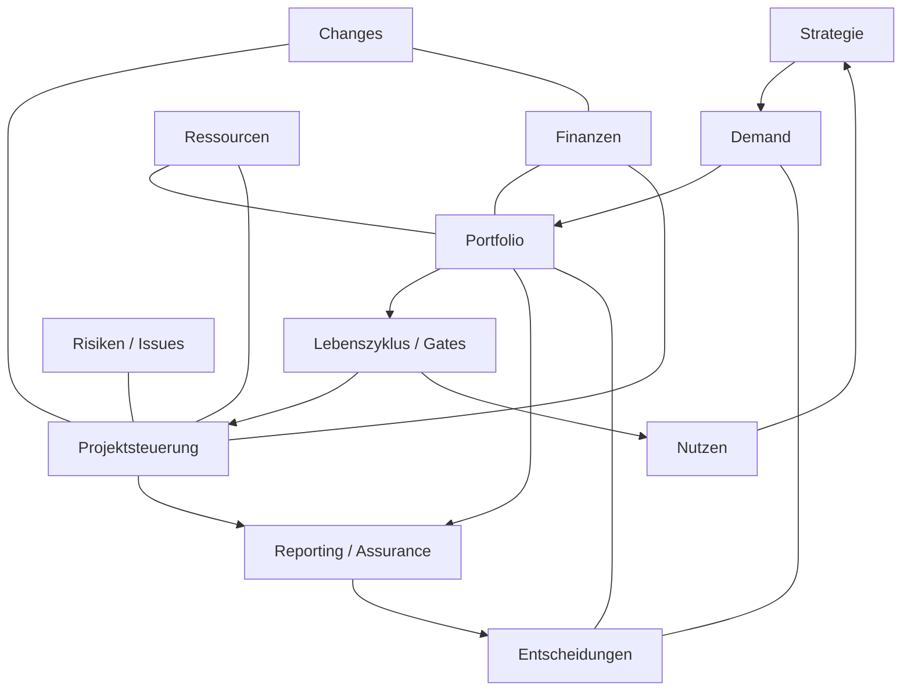

# Projekt-Governance — Gesamtkonzept für eine Nextcloud-App

Fachliches Konzept und Architektur für die Steuerung eines Projektportfolios in einem Unternehmen
mit knappen, zentralen (IT-)Ressourcen. Das Konzept ist bewusst so geschnitten, dass daraus
unmittelbar eine Nextcloud-App abgeleitet werden kann: Jedes Kapitel endet in Entitäten, Zuständen,
Regeln oder Sichten.

Stand: 10.11.2026 · Zusammenführung des Basiskonzepts (08/2026) mit dem Alternativkonzept
„Konzeptgrundlage Projekt-Governance-Software“ (Version 0.1) und der Architekturentscheidung
„eigene App mit Schnittstellen zu Planungstools“.

## Problemstellung

Zwei Steuerungsprobleme werden häufig vermischt und müssen getrennt gelöst werden:

| Ebene | Frage | Instrument |
|---|---|---|
| **Projektmanagement** | Wann brauche ich in *diesem* Projekt welche Ressource? | Projektplan, Gantt, Arbeitspakete |
| **Projekt-Governance** | Welches Projekt bekommt die knappe Ressource *überhaupt* — und warum? Läuft es noch innerhalb seiner Leitplanken? Ist der Nutzen eingetreten? | Portfolio-Bewertung, Gates, Ressourcen-Board, Nutzenreview |

Planungswerkzeuge wie nc_gantt beantworten die erste Frage. Dieses Konzept beantwortet die zweite
und liefert der Planung die verbindliche Eingangsgröße: *freigegebene* Projekte mit *zugesagter*
Kapazität. Die Planung liefert Termine, Fortschritt und Restbedarf zurück.

Typische Ausgangslage: Anfragen kommen über E-Mail und Zuruf · zu viele Vorhaben konkurrieren um
dieselben Engpässe · Entscheidungsrechte sind unklar · Bewertungen sind uneinheitlich · Ablehnungen
sind nicht verbindlich · Stoppen gilt als Scheitern · schlechte Nachrichten kommen spät · Nutzen wird
nach Abschluss nicht überprüft.

## Leitidee

> Ein Vorhaben darf nur so weit voranschreiten, wie sein Wertbeitrag belegt, seine Kapazität
> zugesagt und die Entscheidung dazu dokumentiert ist.

**Leitprinzip für das Produkt:** die richtige Arbeit auswählen, realistisch finanzieren und besetzen,
wirksam steuern, rechtzeitig korrigieren oder stoppen und den erzielten Nutzen überprüfen.

Die Software macht Governance verbindlich und transparent; sie **ersetzt weder Mandat noch
Verantwortung** der Gremien.

## Aufbau

| Dokument | Inhalt |
|---|---|
| [01_Governance_Modell.md](01_Governance_Modell.md) | Ebenen, Prinzipien P1–P12, Gremien inkl. Lenkungsausschuss, Rollen, RACI, Entscheidungsrechte-Matrix, Kadenz, Eskalation, Funktionstrennung, Governance-Kultur, KPIs |
| [02_Portfolio_Lebenszyklus.md](02_Portfolio_Lebenszyklus.md) | Objekthierarchie, Demand-Eingang und Entscheidungscodes, Stage-Gate-Modell G0–G6 mit Beschlussarten, Gate-Sets, Budgettranchen, Statusautomaten, Change/Baselines, Statusbericht und Health-Indikator, Risiken/Issues/Maßnahmen, End-to-End-Ablauf |
| [03_Bewertung_Priorisierung.md](03_Bewertung_Priorisierung.md) | Investment-Buckets, Kriterienkatalog, Wertdichte-Formel, sieben Leitfragen, Business Case mit Annahmen, Nutzenregister, finanzielle Steuerung (Rahmen, Tranchen, Ist, Forecast) |
| [04_Ressourcen_Kapazitaet.md](04_Ressourcen_Kapazitaet.md) | Pools statt Personen, Schlüsselrollen, Kapazitätsrechnung, Allokationsstufen, WIP-Limit, Konflikterkennung, Kapazitätsschnitt, Szenarioanalyse |
| [05_Datenmodell.md](05_Datenmodell.md) | Entitäten, Beziehungen, Felder, Datenherkunft und Daten-Owner, Historisierung, abgeleitete Sichten |
| [06_Tool_Anforderungen.md](06_Tool_Anforderungen.md) | Rollensichten, Berechtigungsmatrix, Workflows, Benachrichtigungen, Berichte, Schnittstellen, NFR inkl. Mandantenfähigkeit und KI, Capability-Katalog mit IDs, Stufenplan/MVP, Einführungsrisiken, offene Konzeptentscheidungen |
| [07_Architektur_Nextcloud.md](07_Architektur_Nextcloud.md) | Entscheidung eigene App, Architektur, Datenhoheit je Feld, Planungs-Provider-Schnittstelle, Anbindung nc_gantt (API v1 vorhanden, v2 benötigt), Nextcloud-Bausteine, öffentliche API, App-Rahmen |
| [Alternativ-Projekt-Governance-Software-Konzept.md](Alternativ-Projekt-Governance-Software-Konzept.md) | Quelldokument, vollständig eingearbeitet (siehe unten); nur noch zur Nachvollziehbarkeit |

## Governance-Landkarte: zwölf Dimensionen

Die zwölf Dimensionen aus dem Alternativkonzept dienen als fachliche Landkarte. Sie sind keine
getrennten Module, sondern greifen ineinander:

| # | Dimension | Kapitel | Capabilities (Kapitel 06, 8.2) |
|---|---|---|---|
| 1 | Strategic Alignment | 02 §1, 03 (N1), 05 | STR-001 |
| 2 | Demand Management | 02 §2 | DEM-001–003 |
| 3 | Portfolio Management | 03, 04 §5 | POR-001–004 |
| 4 | Decision Governance | 01 §3–4, 01 §8, 05 §7 | DEC-001–003, GOV-003 |
| 5 | Project Lifecycle | 02 §3–4 | LIF-001–002 |
| 6 | Project Performance | 02 §4.5 | PRJ-001–003 |
| 7 | Resource Management | 04 | RES-001, POR-004 |
| 8 | Financial Governance | 03 §4, §7 | FIN-001–002 |
| 9 | Risk & Issue Management | 02 §4.6 | RSK-001 |
| 10 | Change Governance | 02 §4.4 | CHG-001 |
| 11 | Benefits Management | 03 §4.1, 02 (G6) | BEN-001–002 |
| 12 | Reporting & Assurance | 01 §10, 05 §10–12, 06 §5 | REP-001–002, AUD-001, DAT-001 |

## Kernannahmen

Diese Annahmen prägen das Modell. Wenn sie in Ihrem Unternehmen anders liegen, sind die
markierten Kapitel anzupassen.

1. **Der Engpass ist Personal, nicht Geld.** Budget ist meist beschaffbar, ein Security-Architekt
   oder ein SAP-Basis-Spezialist nicht. → Priorisierung erfolgt primär gegen Kapazität, Budget ist
   die zweite Restriktion (Kapitel 03 §7, 04).
2. **Nicht alle Projekte konkurrieren im selben Wettbewerb.** Pflichtvorhaben (Regulatorik,
   Lifecycle) und Innovationsvorhaben in denselben Topf zu werfen, führt dazu, dass Innovation
   strukturell nie gewinnt. → getrennte Investment-Buckets (Kapitel 03).
3. **Entscheidungen sind Daten, keine Protokollnotizen.** Jede Freigabe, Ablehnung, Rückstellung
   und Ressourcenzusage ist ein persistiertes, versioniertes Objekt mit Mandat (Kapitel 05).
4. **Priorisierung ohne Sequenzierung ist wirkungslos.** Eine Rangliste hilft nur, wenn daraus
   eine zeitliche Staffelung mit WIP-Limit folgt (Kapitel 04).
5. **Governance endet nicht mit der Freigabe.** Status, Changes, Risiken und Nutzen werden bis
   zum Nutzenreview gesteuert; operative Planung bleibt im Planungstool (Kapitel 01 §1.1, 07).
6. **Mandat vor Werkzeug.** Ohne verabschiedete Entscheidungsrechte digitalisiert das Tool nur
   die Unklarheit (Kapitel 01 §4.2).

## Architekturentscheidung in Kürze

Eigene Nextcloud-App, **nicht** ein Modul von nc_gantt. Planungstools werden über eine
Provider-Schnittstelle angebunden; nc_gantt ist der erste Provider und über `IGanttApi` v1 bereits
weitgehend anbindbar. Für Ressourcenbedarf und Projekt-Events braucht Gantt eine API v2. Details
und Begründung: Kapitel 07.

## Was aus dem Alternativkonzept übernommen wurde

| Punkt | eingearbeitet in |
|---|---|
| Vier Governance-Ebenen, Abgrenzung zum operativen PM, „Software ersetzt kein Mandat“ | 01 §1, §1.1 |
| Zwölf Governance-Dimensionen als Landkarte | README |
| Entscheidungsrechte nach Typ und Schwelle, genau ein „A“, Stellvertretung, Quorum | 01 §4.1–4.2, §8; 05 (DECISION_RIGHT) |
| Projekt-Lenkungsausschuss, Geschäftsführung als Mandatsgeber, Gremienstruktur | 01 §3 |
| Kultur: Sponsorendruck, Stoppen als Scheitern, geschönte Meldungen, Sunk Cost | 01 §9, P10/P11 |
| Antragstypen, Entscheidungscodes inkl. „weitere Analyse“, Wiedervorlage | 02 §2 |
| Gate-Beschlüsse Go/Conditional Go/Hold/Rework/Stop, konfigurierbare Phasenmodelle | 02 §3 |
| Status vs. Beschluss, Eskalation als Kennzeichen, Portfoliophasen | 02 §4.2 |
| Projektgesundheit getrennt von der Statusampel | 02 §4.5, 05 |
| Risiko-Methodik mit Restrisiko, projektübergreifende Risiken, Portfolio-Risikosicht, Maßnahmen | 02 §4.6, 05 |
| Impact Assessment, Baseline-Versionierung, Portfolioauswirkung bei Changes | 02 §4.4, 05 |
| „Priorisierung ist mehr als ein Score“, sieben Leitfragen | 03 Einleitung |
| Finanzielle Steuerung: gestufte Budgetfreigabe, Forecast at Completion, Mehrjahr, Nachfinanzierung | 02 §3, 03 §7 |
| Nutzenregister, Prognose, mehrere Reviews, Benefit Owner außerhalb des PL | 03 §4.1, 01 §4 |
| Strategische Zielhierarchie, Versionierung, M:N-Zuordnung | 02 §1, 05 |
| Portfolio-Szenarien | 04 §5.1, 05 (SCENARIO) |
| Schlüsselrollen sichtbar machen, Abgleich mit HR | 04 §1 |
| KPI-Definition mit Quelle, Owner, Schwellen; Datenherkunft; Daten-Owner | 01 §10, 05 §10 |
| Management-Dashboard, Revisor-Rolle | 06 §2 |
| Mandantenfähigkeit, Funktionstrennung, SSO, Lösch-/Aufbewahrungskonzept | 06 §3, §7 |
| KI mit Leitplanken | 06 §7.1 |
| Capability-Katalog mit IDs, MVP als geschlossener Kreislauf | 06 §8 |
| Einführungsrisiken und offene Konzeptentscheidungen | 06 §9–10 |

**Bewusst nicht übernommen:** das Einheits-Scoring mit Regulatorik als Kriterium (Pflichtvorhaben
laufen hier über Bucket A statt über einen Score) und personen- bzw. skillgenaue Kapazitätsplanung
(hier Pool-Ebene, Kapitel 04 §1).

## Nächste Schritte zur App

1. Offene Konzeptentscheidungen (Kapitel 06 §10) beantworten, vor allem Mandate und Schwellen
2. App-Gerüst nach Kapitel 07 §8 anlegen; Datenmodell der Stufe 1 aus Kapitel 05 ableiten
3. Backlog aus dem Capability-Katalog (Kapitel 06 §8.2) als Issues, Stufe 1 zuerst
4. Parallel in nc_gantt: Issue für `IGanttApi` v2 (Kapitel 07 §5.2), benötigt ab Stufe 4
